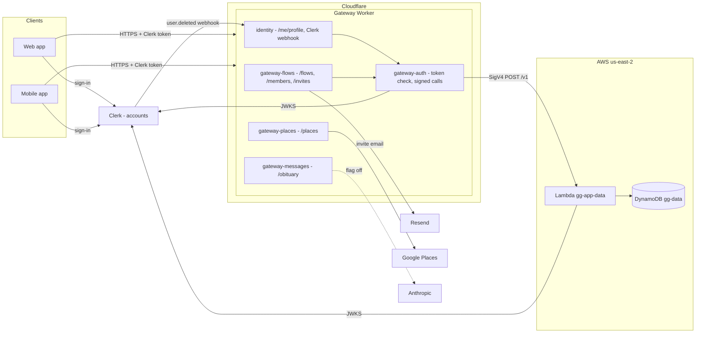
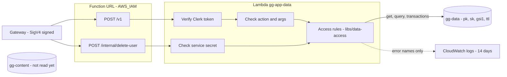
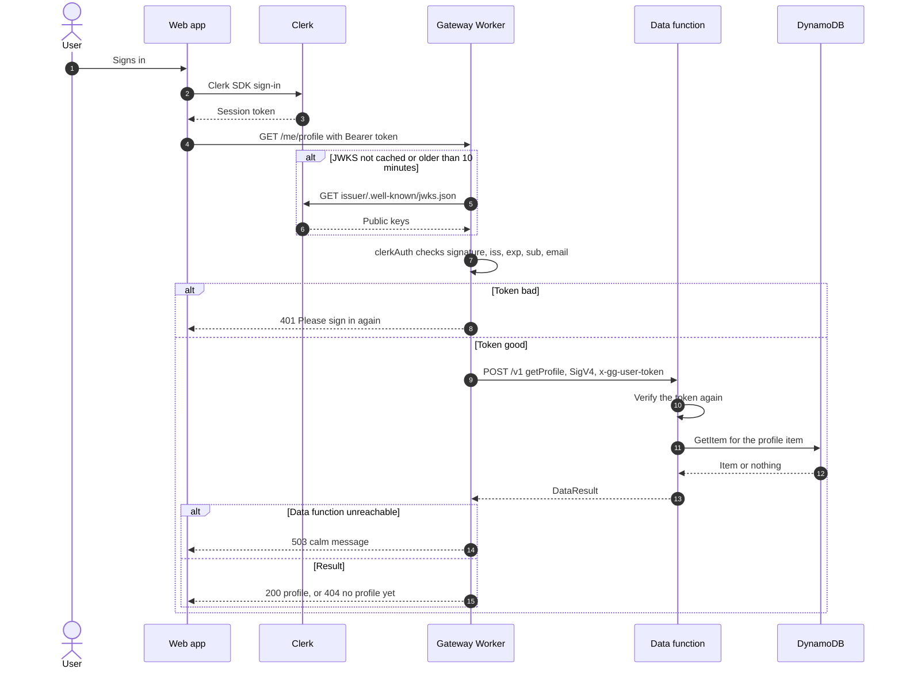
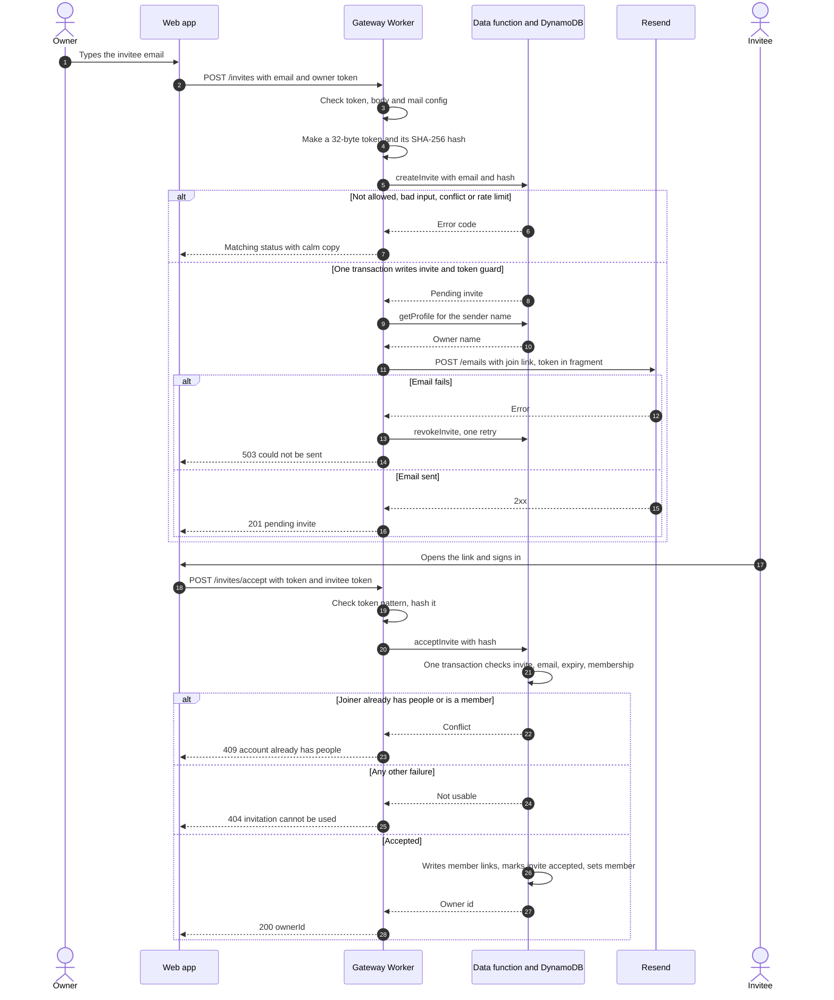
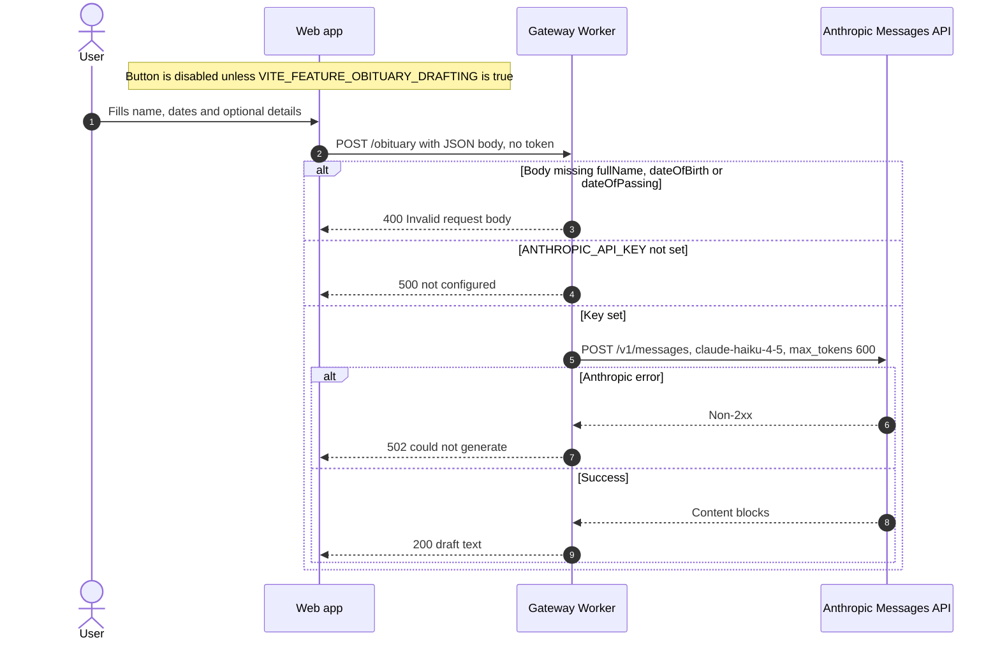
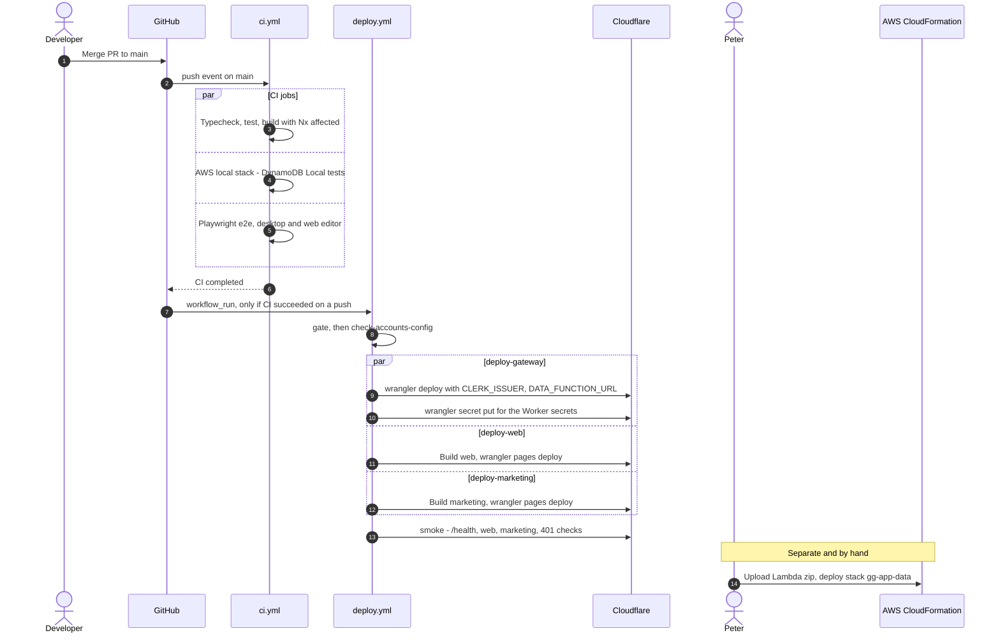
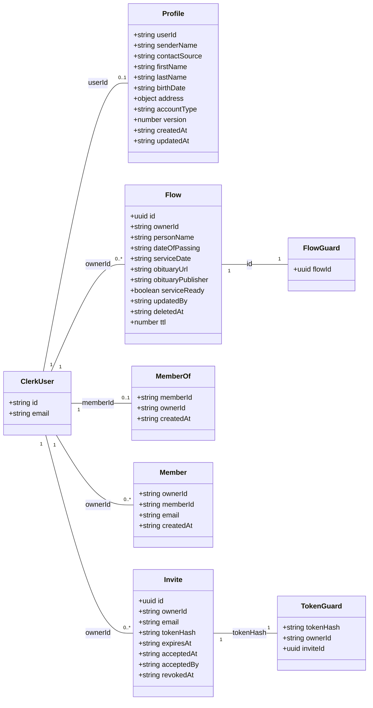
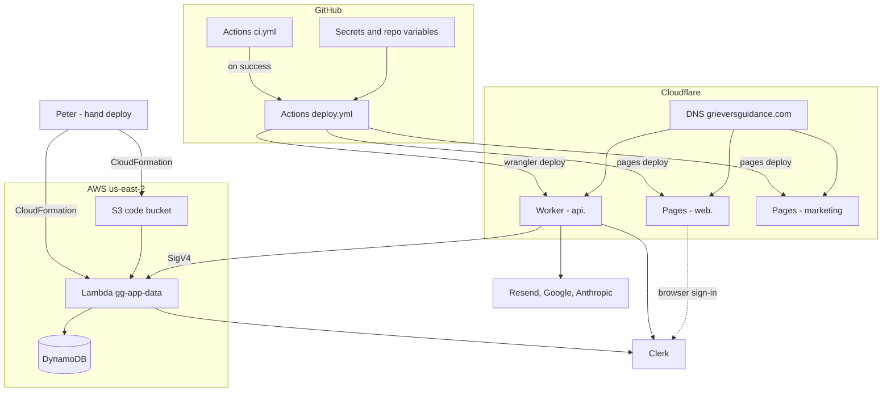

# Backend services

Status: description of the code on `main` at commit `eba550c` (2026-11-17). Accounts are Clerk.
Data is DynamoDB behind the AWS data function (ADR `docs/adr/0002-data-storage.md`). Supabase was
removed in #326 and Convex in #203. Sections and lines marked **History** describe the old stack and
are kept for reference only.

Audience: Peter (product owner) and future developers. Language: ASD-STE100.

How to read this document:

1. Read section 1 for the list of services and their status.
2. Read section 2 for the answer to "do we have too many?".
3. Use section 3 as a reference for one service.
4. Use section 4 for the diagrams.

"Not verified" means: I did not find proof in the repo, and I did not check the live system.

---

## 1. Overview

Griever Guidance is offline-first (C5). Most of the app runs on the phone or in the browser.
The backend does a small number of jobs: it checks who is signed in, stores the profile, the people
and the family-sharing data, sends invite emails, proxies place search, and (behind a flag) drafts
an obituary with AI. We write and host two pieces of server code: the Cloudflare Worker (the gateway)
and the AWS Lambda data function. All other backend services are vendor services.

| Service | Vendor / host | What it does | Used by | Status |
|---|---|---|---|---|
| Gateway (`apps/gateway`) | Cloudflare Workers, `api.grieversguidance.com` | One Hono app. Checks the Clerk token, validates input (C8), calls the data function, Resend, Anthropic and Google Places | Web app, mobile app | **Live** |
| Clerk | Clerk | Sign-up, sign-in, sign-in emails. Issues the session token. Sends the `user.deleted` webhook | Web and mobile apps (Clerk SDKs), gateway and data function (check tokens against Clerk's JWKS) | **Live** (`FEATURE_AUTH=true`) |
| Data function `gg-app-data` | AWS Lambda (Node 22, arm64), `us-east-2`, function URL with `AWS_IAM` | `POST /v1 {action, args}` for the 12 `DATA_ACTIONS`, and the service path `POST /internal/delete-user`. Owns the access rules | Gateway only | **Live**. Deployed by hand (`docs/aws-data-function.md`) |
| DynamoDB | AWS, `us-east-2` | `gg-data`: profiles, people, members, invites. `gg-content`: no user data, no reads yet | Data function only | **Live** |
| Resend | Resend | Sends the invite email for `POST /invites` | Gateway | **Built**. Web sharing UI flag off (`FEATURE_SHARING` is not set) |
| Google Places API (New) | Google | Place search for addresses | Gateway `POST /places/suggest`, `/places/details` | **Built**. Production key: not verified |
| Anthropic Messages API | Anthropic | Drafts an obituary (`claude-haiku-4-5-20251001`, max 600 tokens) | Gateway `POST /obituary` | **Feature-flagged off** in the web build. The production key is probably not set (see 3.7) |
| GitHub Actions | GitHub | CI (`ci.yml`), deploy (`deploy.yml`), `e2e-stress.yml`, `mobile-bundle.yml` | Developers | **Live** |
| Cloudflare Pages + DNS | Cloudflare | Hosts the web app and the marketing site. DNS for `grieversguidance.com` | Users | **Live** (frontend hosting) |

Amazon SES is not in production use. `libs/data-aws/src/ses.ts` has a send helper and CI runs a
local SES stand-in, but no gateway or data-function code calls it. The owner-alert Lambda from plan
v4 is not built.

Counts from the code:

| Thing | Count | Source |
|---|---|---|
| Gateway routes | 17 | `apps/gateway/src/worker.ts` and the five routers (see 3.1) |
| Gateway libraries | 5 (`gateway-auth`, `identity`, `gateway-flows`, `gateway-messages`, `gateway-places`) | `libs/` |
| Data function user actions | 12 | `DATA_ACTIONS` in `libs/shared/src/dataApi.ts` |
| DynamoDB tables | 2 (`gg-data` with index `gsi1`, `gg-content`) | `infra/aws/data.yml` |
| Access-rule modules | 7 | `libs/data-access/src/rules/*.ts` (not counting specs) |

---

## 2. Do we have too many?

**Short answer: the count is about the same as before, but the data now sits in one cloud.** The
backend uses 6 outside vendors (Cloudflare, Clerk, AWS, Resend, Google, Anthropic) plus GitHub for
CI. There is one server data store (DynamoDB, 2 tables).

### 2.1 Overlaps

| Overlap | Evidence | Effect |
|---|---|---|
| Two token checks | The gateway checks the Clerk token, and the data function checks it again (`x-gg-user-token`) | On purpose (defense in depth, ADR 0002). Keep it |
| Two email senders | Clerk sends sign-in emails. Resend sends invite emails | Two sender setups to keep working. Acceptable |
| SES code with no caller | `libs/data-aws/src/ses.ts` and the CI SES stand-in | Small. Keep it only if invite email or an owner alert moves to SES |

### 2.2 Dead weight

| Item | Why it is dead weight | Evidence |
|---|---|---|
| `libs/data-sync` | No source imports it; only `apps/web/package.json` lists it | ADR 0002, REQUIREMENTS §6 |
| `gg-content` table | It exists, and no action reads it | ADR 0002 "What this does not do" |
| `libs/gateway-messages` as its own library | It holds one route (`POST /obituary`) | `libs/gateway-messages/src/router.ts` |

### 2.3 Plan v4: what is built (History of the plan)

Source: `docs/aws-migration-plan.md` (PR #183). Built: Clerk accounts, DynamoDB behind one Lambda
data function with a function URL (`AWS_IAM`), TypeScript access rules tested against DynamoDB Local,
the gateway kept on Workers, Resend kept for invites, and CloudFormation in `infra/aws/` (including
`budgets.yml` and `anomaly.yml`). Not built: `GET /content`, the Clerk `user.created` owner alert
through SES, and an automated deploy of the data function.

**History.** Before #326 the backend was Cloudflare, Supabase (Auth, Postgres, PostgREST), Resend,
Anthropic and GitHub. Access rules were 8 RLS policies and 10 SQL functions, tested by 199 pgTAP
assertions. Before #203, Convex held a session sync that never worked in production.

---

## 3. Services

### 3.1 Gateway (`apps/gateway`)

**Purpose.** The one HTTP API for the apps. It composes the routers from the domain libraries.
`worker.ts` has no domain logic of its own. The same Hono app runs on Workers (`export default app`)
and on Node for local development (`src/main.ts`, port 3001).

**Routes** (17):

| Method | Path | Library | Auth | Calls |
|---|---|---|---|---|
| GET | `/health` | `apps/gateway/src/worker.ts` | None | Nothing |
| GET | `/me/profile` | `libs/identity` | Clerk token | Data action `getProfile` |
| PUT | `/me/profile` | `libs/identity` | Clerk token, write limit | Data action `putProfile` |
| POST | `/webhooks/clerk` | `libs/identity` | Svix signature (`CLERK_WEBHOOK_SECRET`) | Service path `/internal/delete-user`, only for `user.deleted` |
| GET | `/flows` | `libs/gateway-flows` | Clerk token | `listFlows` |
| POST | `/flows` | `libs/gateway-flows` | Clerk token, write limit | `createFlow` |
| PATCH | `/flows/:id` | `libs/gateway-flows` | Clerk token, write limit | `updateFlow` |
| DELETE | `/flows/:id` | `libs/gateway-flows` | Clerk token, write limit | `deleteFlow` |
| GET | `/members` | `libs/gateway-flows` | Clerk token | `listMembers` |
| POST | `/invites` | `libs/gateway-flows` | Clerk token | `createInvite`, `getProfile`, Resend (and `revokeInvite` if the email fails) |
| POST | `/invites/accept` | `libs/gateway-flows` | Clerk token | `acceptInvite` |
| DELETE | `/invites/:id` | `libs/gateway-flows` | Clerk token | `revokeInvite` |
| DELETE | `/members/:memberId` | `libs/gateway-flows` | Clerk token | `removeMember` |
| DELETE | `/membership` | `libs/gateway-flows` | Clerk token | `leaveFamily` |
| POST | `/places/suggest` | `libs/gateway-places` | None, per-IP limit | Google Places |
| POST | `/places/details` | `libs/gateway-places` | None, per-IP limit | Google Places |
| POST | `/obituary` | `libs/gateway-messages` | **None** | Anthropic Messages API |

Every data action is one signed call to the data function: `POST /v1` with SigV4 (`aws4fetch`) as
the IAM user `gg-app-data-worker`, and the caller's Clerk token in `x-gg-user-token`
(`libs/gateway-auth/src/dataFunction.ts`). If the data function cannot be reached, the route answers
a calm 503.

**Data it holds.** None. It keeps a per-isolate cache of Clerk public keys (JWKS) for 10 minutes.

**CORS.** Only origins in `CORS_ORIGINS` (production: `https://web.grieversguidance.com`).
Methods: GET, POST, PUT, PATCH, DELETE. An empty value blocks every origin.

**Configuration (names only):**

| Name | Kind | Set in |
|---|---|---|
| `CORS_ORIGINS`, `INVITE_FROM_EMAIL`, `WEB_URL`, `CLERK_AUTHORIZED_PARTIES` | Worker vars | `apps/gateway/wrangler.toml` |
| `CLERK_ISSUER`, `DATA_FUNCTION_URL` | Worker vars (public) | `deploy.yml` from repo variables |
| `RESEND_API_KEY`, `DATA_FUNCTION_ACCESS_KEY_ID`, `DATA_FUNCTION_SECRET_ACCESS_KEY`, `CLERK_WEBHOOK_SECRET`, `DATA_FUNCTION_SERVICE_SECRET`, `GOOGLE_PLACES_SERVER_KEY` | Worker secrets | `deploy.yml` from GitHub secrets |
| `ANTHROPIC_API_KEY` | Read by `/obituary` | Not set by `deploy.yml` |
| `WRITE_RATE_LIMITER`, `PLACES_RATE_LIMITER` | Rate limiting bindings | `wrangler.toml` `[[ratelimits]]` |

**Deploy.** `deploy.yml` job `deploy-gateway`: `wrangler deploy --config apps/gateway/wrangler.toml`
with `--var` overrides, then the Worker secrets. Custom domain `api.grieversguidance.com` from
`wrangler.toml` `routes`. `compatibility_flags = ["nodejs_compat"]` (the code reads `process.env`).

**Tests.** `apps/gateway/src/routes.spec.ts` (route inventory) and `worker.spec.ts` (health, CORS,
C8 validation, token checks). Production smoke tests in `deploy.yml`: `/health`, the web shell, the
marketing site, tokenless `/me/profile` gives 401, tokenless `POST /invites` gives 401.

**Risks.**

1. `POST /obituary` has no auth and no rate limit (see 3.7).
2. A revoked Clerk signing key can still verify tokens until the 10-minute key cache expires.

### 3.2 Gateway auth (`libs/gateway-auth`)

**Purpose.** The one shared helper lib for the gateway's domain libs (REQUIREMENTS §6 rule 2b).

| Export | What it does |
|---|---|
| `clerkAuth(getConfig)` | Checks the bearer token against `${CLERK_ISSUER}/.well-known/jwks.json`: signature, `iss`, expiry, `sub`, a verified email, and `azp` when set. Sets `userId` and `accessToken`. 401 on a bad token, 503 when config is missing |
| `@griever/gateway-auth/verify-token` | The same token verifier. The data function imports it too |
| `writeRateLimit()` | 120 writes per 60 s per user (3.2.1) |
| `callData` | Signs and sends one data action as the caller |
| `callDeleteUser` | The service call for account deletion, with `x-gg-service-secret` |

**History.** Before #326 this lib held `supabaseAuth` and the PostgREST helpers.

### 3.2.1 Write rate limit (`writeRateLimit`, #530)

**What it does.** Limits write requests (POST, PUT, PATCH, DELETE) under `/flows*` and `/me*` to
**120 per 60 seconds per signed-in user**. Reads are not counted. The middleware runs right after
`clerkAuth`, so the key is the verified Clerk user id (`user:<id>`). If a request somehow has no user,
it is not counted (it already got a 401 from `clerkAuth`). `/members*` and `/invites*` are not covered by this middleware. Only invite creation
has a limit of its own (in the data function). The count is per user, so it is shared across all of that
user's tabs and devices (web and phone together).

| Item | Detail |
|---|---|
| Mechanism | Cloudflare Workers Rate Limiting binding, `[[ratelimits]]` in `apps/gateway/wrangler.toml`. Binding name `WRITE_RATE_LIMITER`, read from the Worker env |
| Over the limit | `429`, `{"error": "You are saving very quickly. Your changes are kept. Please try again in a minute."}`, header `Retry-After: 60` (the window length; the binding does not report time left) |
| No binding | Local dev (`apps/gateway/src/main.ts`) and tests have no binding, so the middleware passes through |
| Limiter error | Passes through. A broken limiter must not block someone saving their work |
| Accuracy | Counts are per Cloudflare location and eventually consistent. This stops runaway clients; it is not an exact quota |
| Client | `libs/api-client` maps 429 to `rate_limited` (flows, profile). `useFlowSync` keeps the edit queued, stops the cycle and retries with backoff of 5, 10, 20, 40 s and on (capped at 5 min); it ignores `Retry-After`, and edits made during the wait do not restart the timer. For flows, nothing local is dropped. A profile save that gets a 429 shows its own calm message and the entered text stays on screen. Copy stays calm (C7) |

**Why 120.** The web autosaves one PATCH after 1 s without typing (`EDIT_DEBOUNCE_MS` in
`libs/hooks/src/useFlowSync.ts`). Writes in one cycle run one after another. Even if someone paused
just over 1 s between every keystroke, that is at most about 50 writes a minute. 120 is more than
double that, so a normal editor never reaches it. A script doing hundreds of writes a minute does.

**How to change it.** Edit `limit` (and `period`, which must be 10 or 60) in the `[[ratelimits]]`
block of `apps/gateway/wrangler.toml` and deploy. If you change `period`, also change
`WRITE_RATE_LIMIT_RETRY_AFTER_SECONDS` in `libs/gateway-auth/src/writeRateLimit.ts`. To turn the limit
off, remove the block. To add routes, mount `writeRateLimit()` after `clerkAuth` in that router.

**Cloudflare setup.** No dashboard step. The binding is created on `wrangler deploy` (needs Wrangler 4.x;
the repo has 4.90). Pick a different `namespace_id` only if `1001` is already used by another rate
limiter on the account. The first deploy needs the Worker's API token to be allowed to edit Workers
scripts, which `deploy.yml` already does.

### 3.3 Profile and account webhook (`libs/identity`)

**Purpose.** `GET` and `PUT /me/profile`: the caller's sender name, contact source, first name, last
name, date of birth and address. `POST /webhooks/clerk`: deletes a user's data after Clerk sends a
verified `user.deleted` event.

| Item | Detail |
|---|---|
| Fields accepted | `senderName` (string up to 100 characters, or null), `contactSource` (`import`, `manual`, or null), `firstName` and `lastName` (each up to 100 characters or null; blank becomes null; no line breaks, tabs or hidden characters), `birthDate` (`yyyy-mm-dd` or null; a real date from 1900 on, not after today), `address` (null, or `{ line1, line2, city, state, zip }`: line 1, city, 2-letter state and ZIP of 5 or 5+4 digits are required when any part is filled). `senderName` is set from `firstName` on save. `fullName` is still accepted from older clients and is split into first and last name; the response also carries a derived read-only `fullName`. `firstName`, `lastName`, `birthDate` and `address` are private to the account and never shown to members. Any other key gives 400 |
| Data calls | `getProfile` and `putProfile`. The profile item is `USER#<id>` / `PROFILE` in `gg-data`. The email is not stored |
| Errors | The data function unreachable or busy gives a calm 503 (C7) |
| Webhook | Svix signature check, then `callDeleteUser`. With no service secret set the delete path is off and the webhook answers 503 |
| Tests | 2 spec files (`profileRouter.spec.ts`, `clerkWebhook.spec.ts`) |

### 3.4 People and family sharing (`libs/gateway-flows`)

**Purpose.** The person routes (`/flows`), invites and members. Every route is behind `clerkAuth`.
Every read and write is one data action run as the caller.

| Route | Data action | Notes |
|---|---|---|
| `GET /members` | `listMembers` | |
| `POST /invites` | `createInvite`, then `getProfile`, then Resend | Email failure → `revokeInvite` (one retry), 503 |
| `POST /invites/accept` | `acceptInvite` | Conflict or already a member → 409. Every other failure → 404 "can't be used" |
| `DELETE /invites/:id` | `revokeInvite` | 204 |
| `DELETE /members/:memberId` | `removeMember` | 204 |
| `DELETE /membership` | `leaveFamily` | Not a member → 404 |

**Invite token.** 32 random bytes, base64url (43 characters). Only the SHA-256 hex is stored. The
link is `${WEB_URL}/join#t=<token>`. The token is in the fragment, so it stays out of server logs.

**Limits (in `libs/data-access/src/rules/invites.ts`).** 10 invites per owner in 24 hours. 20 open
invites per owner. One open invite per owner and email. Invites expire after 7 days. Each create and
each accept is one conditional DynamoDB transaction.

**Email content (C1).** Subject and text use only the owner's cleaned sender name and the link.
No contact, message or deceased-person data.

**Tests.** Router specs, `mailer.spec.ts`, `inviteToken.spec.ts`, and `sharing.integration.spec.ts`
(runs in the CI `aws-local` job).

### 3.5 Data function and DynamoDB (`libs/data-access`, `infra/aws/data.yml`)

**Purpose.** The only code that reads or writes the tables (ADR 0002).

| Item | Detail |
|---|---|
| Lambda | `gg-app-data`, Node 22, arm64, `us-east-2`, 14-day log group |
| Entry | Function URL with `AWS_IAM`. An unsigned call gets 403 from AWS |
| `POST /v1` | Checks `x-gg-user-token` against Clerk's JWKS, then the envelope `{action, args}`, then the args. 401 on a bad token, 400 on a bad body. Domain outcomes answer 200 with a `DataResult` |
| `POST /internal/delete-user` | No user token. Needs SigV4 and `x-gg-service-secret` (constant-time compare). 404 when no secret is set |
| Access rules | `libs/data-access/src/rules/*`: profiles, flows, invites, acceptInvite, members, deleteUser. They enforce C11 |
| Worker IAM user | `gg-app-data-worker`: may invoke this function through its URL only. It cannot read the tables |

**Tables.**

| Table | Keys | Holds |
|---|---|---|
| `gg-data` | `pk`, `sk`; index `gsi1` (`gsi1pk`, `gsi1sk`); TTL on `ttl` | Profiles, people, member links, invites and token guards (see 4.7) |
| `gg-content` | | No user data. No action reads it yet |

Both tables are on demand, with point-in-time recovery and deletion protection. A deleted person
gets a `ttl` of 90 days and DynamoDB purges it (#216).

**Tests.** Unit specs for every rule and item, and integration specs against DynamoDB Local in the
CI `aws-local` job.

**History: Supabase (removed in #326).** Supabase Auth (email and password) issued ES256 tokens.
Postgres held `profiles`, `memberships`, `invites` and `flows`, read through PostgREST under the
caller's JWT. Access rules were 8 RLS policies and 10 SQL functions, tested by 199 pgTAP assertions.
It held only test data, so nothing was moved (ADR 0002).

### 3.6 Convex (History, removed in #203)

Before removal it held cursor sync for session documents (`sync:pull`, `sync:push`, a purge cron)
behind `requireUser`, which threw in production, so no sync call ever succeeded for a user. The
Convex data was test data and was not exported.

### 3.7 Anthropic (`POST /obituary`, `libs/gateway-messages`)

**Purpose.** Draft a 150 to 200 word obituary from form fields.

| Item | Detail |
|---|---|
| Required body fields | `fullName`, `dateOfBirth`, `dateOfPassing` (non-empty strings) |
| Optional | `cityOfResidence`, `survivors`, `career`, `personalNote` |
| Call | `POST https://api.anthropic.com/v1/messages`, model `claude-haiku-4-5-20251001`, `max_tokens` 600 |
| Answers | 200 `{ draft }`; 400 bad body; 500 when `ANTHROPIC_API_KEY` is unset; 502 when Anthropic fails |
| Secret | `ANTHROPIC_API_KEY` |
| Flag | `VITE_FEATURE_OBITUARY_DRAFTING` (web). `deploy.yml` does not pass it, so it is off |
| Tests | `libs/gateway-messages` has no spec files. Gateway specs check only the 400 on an empty body |

**Status in production.** `deploy.yml` does not set `ANTHROPIC_API_KEY`, so the route probably
answers 500 in production. A key set by hand on the Worker: not verified.

**Risks.**

1. No auth and no rate limit. If a key is set, anyone on the internet can spend Anthropic credit.
2. The request sends the deceased person's name and dates, and family names, to a third party.
   Privacy text and a decision are needed before the flag goes on.

### 3.8 Resend (invite email)

| Item | Detail |
|---|---|
| Call | `POST https://api.resend.com/emails`, text only |
| Sender | `INVITE_FROM_EMAIL` = `Grievers Guidance <invites@grieversguidance.com>` (`wrangler.toml`) |
| Secret | `RESEND_API_KEY` (Worker secret, set by `deploy.yml` from the GitHub secret) |
| No key | `POST /invites` answers 503 and makes no invite |
| Results | 2xx ok; 429 rate limited; 400 or 422 rejected; other unavailable. Any failure revokes the invite |
| Tests | `libs/gateway-flows/src/mailer.spec.ts` |
| Risk | Invitee email addresses go to a third party. Retention is open (issue #146) |

### 3.9 GitHub Actions (CI and deploy)

| Workflow | Trigger | Jobs |
|---|---|---|
| `ci.yml` | Push to `main`, every PR | `Typecheck, unit + integration tests, build` (Nx affected; forbids `.only`, `.skip`, `.todo`); `AWS local stack` (DynamoDB Local and the SES stand-in; tests `data-aws`, `data-access`, `gateway-flows`); `e2e` (Playwright desktop, then the web editor with the flag on) |
| `deploy.yml` | CI success on a push to `main`, or manual | `gate` → `check-accounts-config` → `deploy-gateway`, `deploy-web`, `deploy-marketing` (parallel) → `smoke` |
| `e2e-stress.yml` | Not read in detail | Repeat e2e runs (AGENTS.md) |
| `mobile-bundle.yml` | Not read in detail | Mobile bundle check (not verified) |

`deploy-gateway` order: build `shared` → `wrangler deploy` with `CLERK_ISSUER` and
`DATA_FUNCTION_URL` → Worker secrets. `deploy.yml` does not deploy the data function or any AWS
stack. Peter deploys those by hand with CloudFormation (`docs/aws-data-function.md`).

---

## 4. UML diagrams

All diagrams are Mermaid. GitHub renders them. They show the code on `main` at `eba550c`.

### 4.1 Component diagram: current system

The apps never call AWS. Only the gateway holds the AWS key (REQUIREMENTS §6 rule 2a).

### 4.2 Component diagram: inside the data function

`gg-content` exists in `infra/aws/data.yml`, but no action reads it.

### 4.3 Sequence: sign-in and `GET /me/profile`

### 4.4 Sequence: create an invite and accept it

### 4.5 Sequence: `POST /obituary`

This route has no data-function or DynamoDB call.

### 4.6 Sequence: deploy pipeline

`deploy.yml` has no AWS step. The data function and the tables change only when Peter deploys them.

### 4.7 Class diagram: data model (`gg-data` items)

Each class is one kind of item in the one table. User ids are Clerk ids (the token `sub`): plain
strings of 1 to 64 letters, digits, `_` or `-` (`isUserId` in `libs/shared`). Flow and invite ids
are UUIDs (#533).

Keys (built only in `libs/data-access/src/keys.ts`):

| Item | `pk` | `sk` |
|---|---|---|
| Profile | `USER#<userId>` | `PROFILE` |
| Flow | `USER#<ownerId>` | `FLOW#<id>` |
| FlowGuard | `FLOW#<id>` | `FLOW` |
| MemberOf | `USER#<memberId>` | `MEMBER_OF` |
| Member | `USER#<ownerId>` | `MEMBER#<memberId>` |
| Invite | `USER#<ownerId>` | `INVITE#<id>` |
| TokenGuard | `TOKEN#<tokenHash>` | `TOKEN` |

Notes on the model:

1. `ClerkUser` lives in Clerk, not in DynamoDB. The profile does not store the email.
2. A flow item also holds the person detail keys (`FLOW_DETAIL_KEYS` in `libs/shared`). They are
   left out of the diagram to keep it short.
3. `gsi1` (`REF#<userId>`) points at flows a user last updated and invites a user accepted. Only
   account deletion uses it.
4. The guard items make a flow id and a token hash unique across all owners. A token guard stays
   after a revoke, so a used hash can never be used again.
5. Members read and update the owner's flows through the rules in `libs/data-access/src/rules/flows.ts`.

### 4.8 Deployment diagram: current

`infra/aws/` also has `github-oidc.yml`, `budgets.yml` and `anomaly.yml`. No workflow uses them
today, and whether they are deployed is not verified.

---

## 5. Open questions

1. **`/obituary`: on or off?** Recommendation: add `clerkAuth` and a rate limit before the flag goes
   on. Decide what privacy text the user sees. Confirm whether `ANTHROPIC_API_KEY` is set on the
   Worker (`wrangler secret list`).
2. **Data function deploy.** It is a hand deploy. Move code-only deploys into `deploy.yml` with the
   OIDC role (`infra/aws/github-oidc.yml`)?
3. **SES.** The helper and the CI stand-in exist with no caller. Keep them for a later owner alert or
   invite email on SES, or remove them?
4. **`gg-content`.** The table exists and nothing reads it. Build `GET /content`, or leave it?
5. **Rename `libs/gateway-flows`?** It holds people, members and invites. Low priority.
6. **Costs.** The repo has no billing data for Cloudflare, Clerk, AWS, Resend, Google or Anthropic.
   The AWS budget is $10 a month (ADR 0002).

---

## 6. Sources

Code and configuration:

- `apps/gateway/src/worker.ts`, `apps/gateway/wrangler.toml`
- `libs/gateway-auth/src/clerkAuth.ts`, `verifyToken.ts`, `dataFunction.ts`, `writeRateLimit.ts`
- `libs/identity/src/profileRouter.ts`, `clerkWebhook.ts`
- `libs/gateway-flows/src/flowsRouter.ts`, `membersRouter.ts`, `mailer.ts`
- `libs/gateway-places/src/router.ts`, `google.ts`
- `libs/gateway-messages/src/router.ts`, `obituaryRoute.ts`
- `libs/shared/src/dataApi.ts`
- `libs/data-access/src/handler/app.ts`, `keys.ts`, `items/*.ts`, `rules/*.ts`
- `libs/data-aws/src/ses.ts`
- `infra/aws/data.yml`, `artifacts.yml`, `github-oidc.yml`, `budgets.yml`, `anomaly.yml`
- `.github/workflows/ci.yml`, `.github/workflows/deploy.yml`

Documents:

- `REQUIREMENTS.md` §6
- `docs/adr/0002-data-storage.md`
- `docs/aws-data-function.md`, `docs/aws-migration-plan.md`

Live repo metadata (names only, no values printed except feature flags):

- `gh variable list` (2026-11-17): `FEATURE_AUTH`, `FEATURE_CMS`, `FEATURE_SYNC` are `true`;
  `FEATURE_SHARING` is not set
