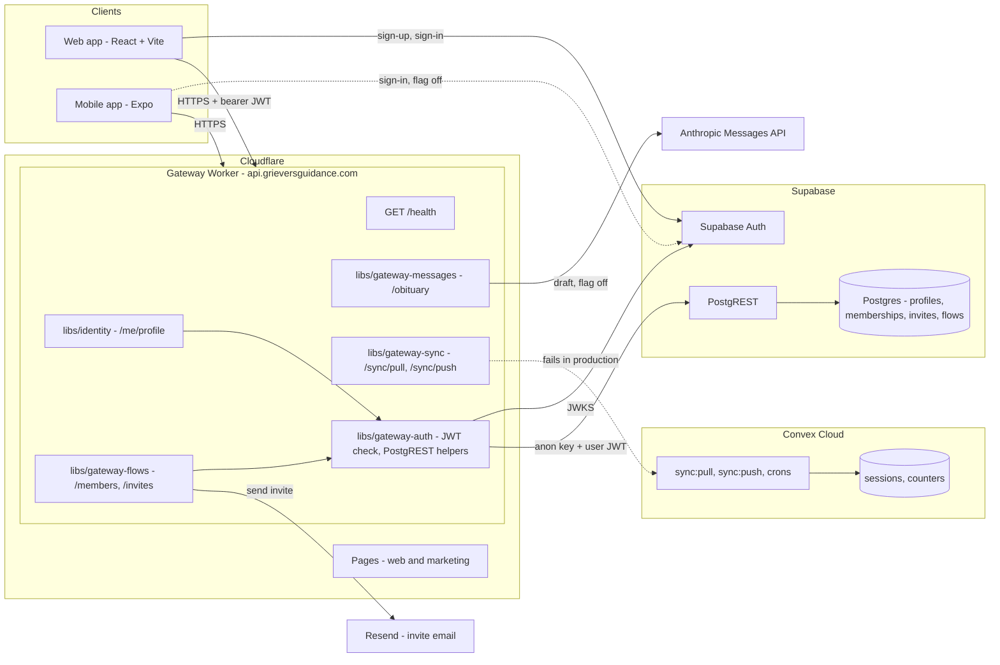
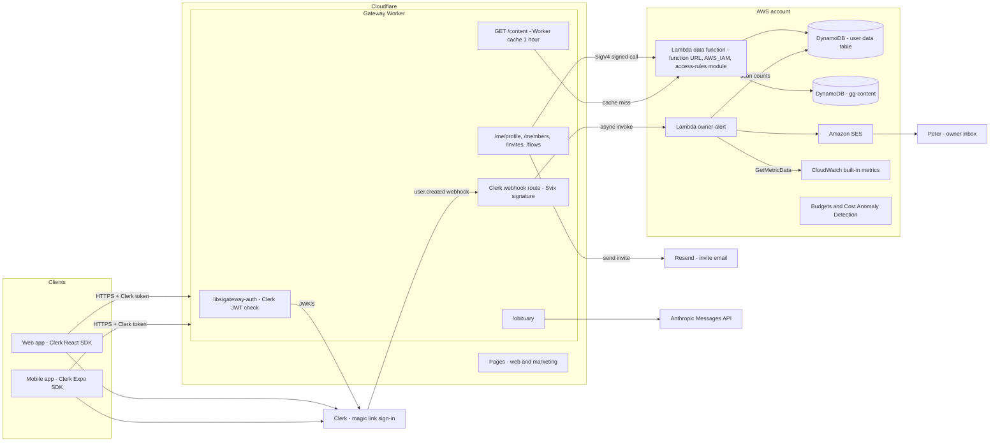
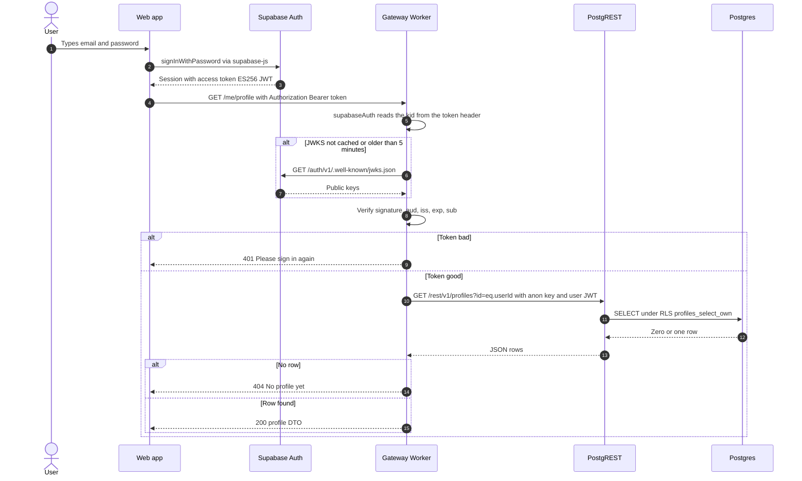
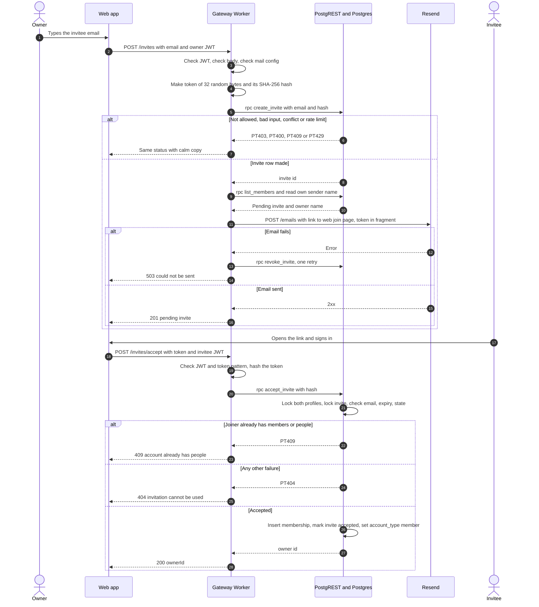
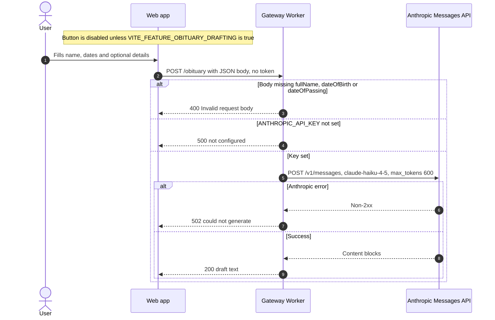
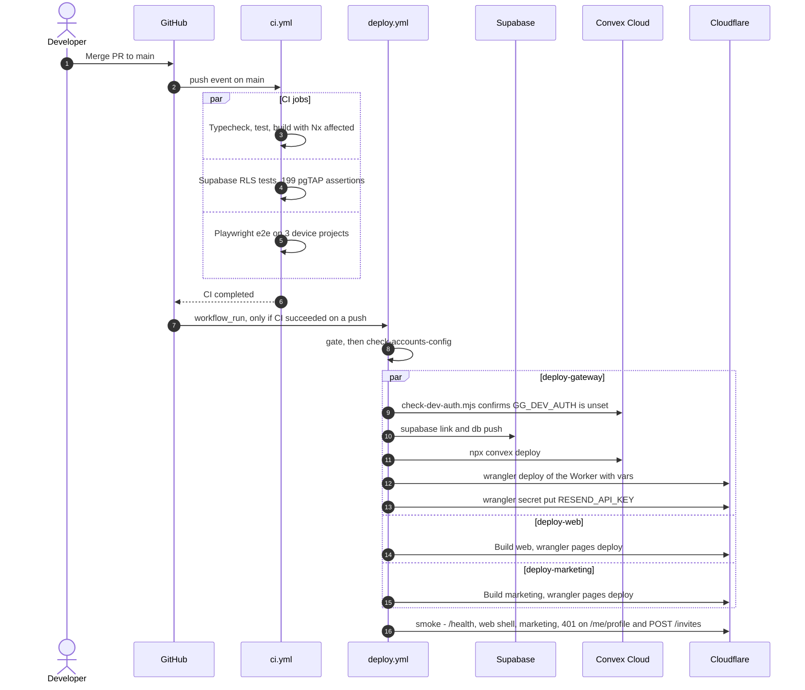
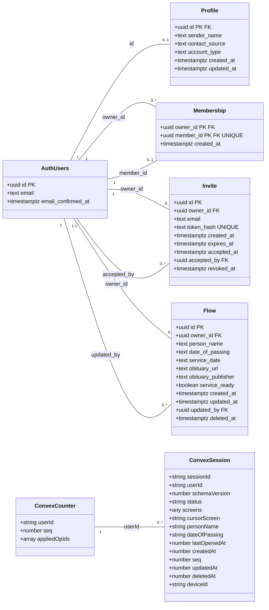
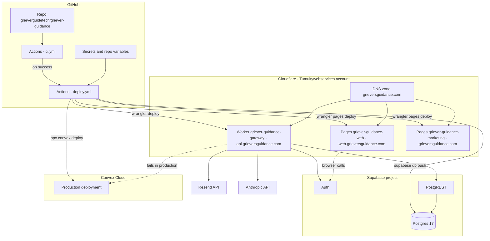

# Backend services

Status: description of the code on `main` at commit `c164258` (2026-10-20). The target state in
section 2 is a proposal. PR #183 (merged) added the plan in `docs/aws-migration-plan.md`. It is not built.

Audience: Peter (product owner) and future developers. Language: ASD-STE100.

How to read this document:

1. Read section 1 for the list of services and their status.
2. Read section 2 for the answer to "do we have too many?".
3. Use section 3 as a reference for one service.
4. Use section 4 for the diagrams.

"Not verified" means: I did not find proof in the repo, and I did not check the live system.

---

## 1. Overview

Griever Guidance is offline-first (C5). Most of the app runs on the phone or in the browser.
The backend does a small number of jobs: it signs people in, stores the profile and family-sharing
data, sends invite emails, and (behind a flag) drafts an obituary with AI. One Cloudflare Worker
(the gateway) is the only server code that we write and host. All other backend services are
vendor services. The gateway calls them, or the apps call them for sign-in only.

| Service | Vendor / host | What it does | Used by | Status | Monthly cost |
|---|---|---|---|---|---|
| Gateway (`apps/gateway`) | Cloudflare Workers, `api.grieversguidance.com` | One Hono app. Checks tokens, validates input (C8), calls Supabase, Resend, Anthropic and Convex | Web app; mobile app (only `/obituary` today) | **Live** | Not known (no billing data in repo) |
| Supabase Auth | Supabase | Sign-up, sign-in, password reset, sign-in emails. Issues the access token (ES256 JWT) | Web app (supabase-js), mobile app (flag off), gateway (checks JWKS) | **Live on web** (`FEATURE_AUTH=true`). Mobile flag off | Not known |
| Supabase Postgres + PostgREST | Supabase | Tables `profiles`, `memberships`, `invites`, `flows`. RLS and definer functions enforce the access rules | Gateway only | **Live** for `profiles`. `memberships` and `invites`: server live, UI flag off. `flows`: table built, **no gateway route** | Not known |
| Convex Cloud | Convex | Tables `sessions` and `counters`, cursor sync (`sync:pull`, `sync:push`), a daily purge cron | Gateway `/sync/*` routes | **Built, deployed on every push to `main`, never worked in production.** `requireUser` always throws in production | Not known |
| Convex self-hosted | Docker on a developer machine | The same Convex functions, for local development | Developers | Local only | $0 |
| Resend | Resend | Sends the invite email for `POST /invites` | Gateway | **Built, UI flag off** (`FEATURE_SHARING` is not set) | Not known |
| Anthropic Messages API | Anthropic | Drafts an obituary (`claude-haiku-4-5-20251001`, max 600 tokens) | Gateway `POST /obituary` | **Feature-flagged off** in the web build. The production key is probably not set (see 3.7) | Pay per token. Not measured |
| GitHub Actions | GitHub | CI (`ci.yml`), deploy (`deploy.yml`), `e2e-stress.yml`, `mobile-bundle.yml` | Developers | **Live** | Not known |
| Cloudflare Pages + DNS | Cloudflare | Hosts the web app and the marketing site. DNS for `grieversguidance.com` | Users | **Live** (frontend hosting, not a backend service) | Not known |
| PostHog | PostHog | Nothing. Only two GitHub secrets exist (`VITE_POSTHOG_HOST`, `VITE_POSTHOG_PROJECT_TOKEN`) | Nothing | **Unused.** No code reads these names | $0 (not verified) |

Counts from the code:

| Thing | Count | Source |
|---|---|---|
| Gateway routes (served) | 11 | `apps/gateway/src/worker.ts` and the four routers |
| Gateway routes the client calls but the gateway does not serve | 3 (`GET /flows`, `POST /flows`, `PATCH /flows/:id`) | `libs/api-client/src/flows.ts`; issue #131 is open |
| Gateway libraries | 5 (`gateway-auth`, `identity`, `gateway-flows`, `gateway-messages`, `gateway-sync`) | `libs/` |
| Supabase tables | 4 | `infra/supabase/migrations/` (4 files) |
| Supabase RLS policies | 8 | same |
| Supabase functions | 10 (5 RPC, 1 policy helper, 4 trigger functions) | same |
| pgTAP assertions | 199 (14 + 41 + 80 + 64) in 4 files | `infra/supabase/tests/*.sql` |
| Convex tables | 2 (`sessions`, `counters`) | `apps/gateway/convex/schema.ts` |
| Convex functions | 4 (`sync:pull`, `sync:push`, `crons:purgeOldDeleted`, `crons:deleteEverything`) | `apps/gateway/convex/sync.ts`, `crons.ts` |
| GitHub secrets | 11 names | `gh secret list` |
| GitHub repo variables | 3 (`FEATURE_AUTH`, `SUPABASE_URL`, `SUPABASE_ANON_KEY`) | `gh variable list` |

---

## 2. Do we have too many?

**Short answer: yes, for the work the backend does today.** We have 6 outside vendors in the
backend path (Cloudflare, Supabase, Convex, Resend, Anthropic, GitHub), plus one unused vendor
(PostHog). We have 3 server-side data stores (Supabase Postgres, Convex Cloud, Convex Docker) for
an app whose main data stays on the device. Only one of them (Supabase Postgres) holds data that a
user can see in production.

### 2.1 Overlaps

| Overlap | Evidence | Effect |
|---|---|---|
| Two server databases for "sync" | Convex holds `sessions` (DATA.md §3). Supabase holds `flows` (DATA.md "Shared people"). REQUIREMENTS §6 says the Convex sync "is not the plan" | Two sync protocols, two client libraries (`libs/data-sync` and `useFlowSync` in `libs/hooks`) |
| Two Convex deployments | Convex Cloud for production, Docker for local (`infra/convex/README.md`) | Extra setup and secrets (`CONVEX_DEPLOY_KEY`, `CONVEX_URL`) for a service that does not work in production |
| Two places that enforce access rules | RLS and definer functions in Postgres, plus input checks in the gateway | This is on purpose (defense in depth). Keep it |
| Two email senders | Supabase Auth sends sign-in emails. Resend sends invite emails | Two sender domains to keep verified. Acceptable |

### 2.2 Dead weight

| Item | Why it is dead weight | Evidence |
|---|---|---|
| Convex Cloud + `libs/gateway-sync` + `libs/data-sync` + `/sync/pull`, `/sync/push` | `requireUser` throws `auth not configured` when `GG_DEV_AUTH` is not set, and production never sets it | `apps/gateway/convex/auth.ts`; `scripts/check-dev-auth.mjs`; REQUIREMENTS §6 Identity; issue #203 |
| Convex deploy step in `deploy.yml` | Deploys functions that cannot run for a real user | `.github/workflows/deploy.yml` (`npx convex deploy`) |
| `crons:deleteEverything` | Reads a `users` table that is not in `schema.ts` | `apps/gateway/convex/crons.ts` vs `schema.ts`. Whether Convex deploy accepts this: not verified |
| PostHog secrets | No code reads them | `grep -ri posthog` finds nothing outside `node_modules` |
| GitHub secret `VITE_API_URL` | `deploy.yml` hard-codes `VITE_API_URL`. No workflow reads the secret | `.github/workflows/deploy.yml` |
| `libs/gateway-messages` as its own library | It holds one route (`POST /obituary`). Sending moved to the phone | `libs/gateway-messages/src/router.ts` |
| `libs/gateway-flows` name | It holds members and invites, not flows. The `/flows` routes do not exist yet | `libs/gateway-flows/src/index.ts` |

### 2.3 What we can remove now, without the AWS plan

1. Retire Convex (issue #203; #140 was closed as a duplicate): remove `apps/gateway/convex`, `libs/gateway-sync`,
   `libs/data-sync`, `infra/convex`, the Convex deploy step and the two Convex secrets.
2. Delete the unused secrets `VITE_POSTHOG_HOST`, `VITE_POSTHOG_PROJECT_TOKEN` and `VITE_API_URL`
   (ask Peter first; PostHog may be planned).
3. Decide on `/obituary` (see 3.7): turn it on with auth and a rate limit, or remove it.

These three steps take the backend from 6 vendors to 5, and from 3 server data stores to 1.

### 2.4 Target state (proposed, plan merged in PR #183, not done)

Source: `docs/aws-migration-plan.md` (added by PR #183, merged). Plan v4
decisions:

1. Clerk (magic link, no password) replaces Supabase Auth.
2. Amazon DynamoDB replaces Supabase Postgres. No RDS.
3. DynamoDB also holds content (`gg-content` table: checklist, samples, examples).
4. The gateway stays on Cloudflare Workers.
5. Convex is removed.
6. An owner alert to Peter goes through Amazon SES (one email for each new account).
7. Resend stays for invite emails.

Before and after:

| Area | Before (today) | After (plan v4, proposed) |
|---|---|---|
| Sign-in | Supabase Auth (email + password) | Clerk (magic link) |
| User data | Supabase Postgres via PostgREST | DynamoDB via one Lambda data function (function URL, `AWS_IAM`) |
| Access rules | RLS + definer functions (SQL) | One TypeScript access-rules module in the Lambda |
| Rule tests | 199 pgTAP assertions | Same cases as Vitest against DynamoDB Local |
| Session sync | Convex Cloud (does not work) | Removed |
| Content | Code in the apps | DynamoDB `gg-content`, `GET /content`, cached 1 hour in the Worker |
| Invite email | Resend | Resend |
| Owner alert | None | Clerk `user.created` webhook → gateway → Lambda `owner-alert` → SES |
| Usage counts | None | CloudWatch built-in Lambda and DynamoDB metrics |
| AI obituary | Anthropic | Anthropic |
| Cost guard | None | AWS Budgets + Cost Anomaly Detection |
| Infra as code | `wrangler.toml`, Supabase migrations | Plus CloudFormation (`infra/aws/`) |

Vendor and service count:

| Count | Before | After (plan v4) |
|---|---|---|
| Backend vendors in use | 6 (Cloudflare, Supabase, Convex, Resend, Anthropic, GitHub) | 6 (Cloudflare, Clerk, AWS, Resend, Anthropic, GitHub) |
| Unused vendors | 1 (PostHog secrets) | 0 if the secrets are deleted (not in the plan) |
| Server data stores | 3 (Supabase Postgres, Convex Cloud, Convex Docker) | 1 (DynamoDB, 2 tables) |
| Runtime services we call | 6 (Worker, Supabase Auth, PostgREST, Convex Cloud, Resend, Anthropic) | 9 (Worker, Clerk, Lambda data, DynamoDB, Lambda owner-alert, SES, CloudWatch, Resend, Anthropic) |
| Services that do not work in production | 1 (Convex) | 0 |
| Estimated AWS cost | n/a | about $0.10 now, about $0.80 at 10 times the load (plan v4 "Cost") |

**Assessment.** Plan v4 removes the dead service (Convex) and the second database. It does not
reduce the vendor count: Supabase becomes Clerk plus AWS. It adds more small AWS parts (two
Lambda functions, SES, CloudWatch, Budgets, IAM, CloudFormation), but they sit in one account
under one bill. The biggest simplification (removing Convex) does not need the AWS move. Do it
first (2.3).

---

## 3. Services

### 3.1 Gateway (`apps/gateway`)

**Purpose.** The one HTTP API for the apps. It composes 4 routers from libraries. `worker.ts`
has no domain logic of its own. The same Hono app runs on Workers (`export default app`) and on
Node for local development (`src/main.ts`, port 3001).

**Routes** (11):

| Method | Path | Library | Auth | Calls | Status |
|---|---|---|---|---|---|
| GET | `/health` | `apps/gateway/src/worker.ts` | None | Nothing | Live, smoke-tested |
| GET | `/me/profile` | `libs/identity` | Supabase JWT | PostgREST `profiles` | Live |
| PUT | `/me/profile` | `libs/identity` | Supabase JWT | PostgREST `profiles` (PATCH, then POST) | Live |
| GET | `/members` | `libs/gateway-flows` | Supabase JWT | RPC `list_members` | Live, UI flag off |
| POST | `/invites` | `libs/gateway-flows` | Supabase JWT | RPC `create_invite`, `list_members`, PostgREST `profiles`, Resend | Live, UI flag off |
| POST | `/invites/accept` | `libs/gateway-flows` | Supabase JWT | RPC `accept_invite` | Live, UI flag off |
| DELETE | `/invites/:id` | `libs/gateway-flows` | Supabase JWT | RPC `revoke_invite` | Live, UI flag off |
| DELETE | `/members/:memberId` | `libs/gateway-flows` | Supabase JWT | RPC `remove_member` | Live, UI flag off |
| POST | `/obituary` | `libs/gateway-messages` | **None** | Anthropic Messages API | Deployed, web flag off |
| GET | `/sync/pull` | `libs/gateway-sync` | `x-gg-user` header only | Convex `sync:pull` | Fails in production |
| POST | `/sync/push` | `libs/gateway-sync` | `x-gg-user` header only | Convex `sync:push` | Fails in production |

Not served, but called by `libs/api-client/src/flows.ts`: `GET /flows`, `POST /flows`,
`PATCH /flows/:id` (issue #131).

**Data it holds.** None. It keeps a per-isolate cache of Supabase public keys (JWKS) for 5 minutes.

**CORS.** Only origins in `CORS_ORIGINS` (production: `https://web.grieversguidance.com`).
Methods: GET, POST, PUT, DELETE. An empty value blocks every origin.

**Configuration (names only):**

| Name | Kind | Set in |
|---|---|---|
| `CORS_ORIGINS` | Worker var | `apps/gateway/wrangler.toml` |
| `SUPABASE_URL`, `SUPABASE_ANON_KEY` | Worker vars (public) | `wrangler.toml` (empty), overridden by `deploy.yml` from repo variables |
| `INVITE_FROM_EMAIL`, `WEB_URL` | Worker vars | `wrangler.toml` |
| `RESEND_API_KEY` | Worker secret | `deploy.yml` from the GitHub secret |
| `CONVEX_URL` | Worker var | `deploy.yml` from the GitHub secret |
| `ANTHROPIC_API_KEY` | Read by `/obituary` | `apps/gateway/.env.example` only. Not set by `deploy.yml` |
| `PORT`, `CONVEX_SELF_HOSTED_URL`, `CONVEX_SELF_HOSTED_ADMIN_KEY`, `CONVEX_SITE_URL` | Local only | `apps/gateway/.env.example` |
| `CLOUDFLARE_API_TOKEN`, `CLOUDFLARE_ACCOUNT_ID` | GitHub secrets, deploy only | `deploy.yml` |

**Deploy.** `deploy.yml` job `deploy-gateway`: `wrangler deploy --config apps/gateway/wrangler.toml`
with `--var` overrides. Custom domain `api.grieversguidance.com` from `wrangler.toml` `routes`.
`compatibility_flags = ["nodejs_compat"]` (the code reads `process.env`).

**Tests.** `apps/gateway/src/routes.spec.ts` (route inventory; every route refuses an empty or
tokenless request) and `worker.spec.ts` (health, CORS, C8 validation, JWT checks). About 24 test
cases. Production smoke tests in `deploy.yml`: `/health`, tokenless `/me/profile` gives 401,
tokenless `POST /invites` gives 401.

**Risks.**

1. `POST /obituary` has no auth and no rate limit (see 3.7).
2. `/sync/*` trusts the `x-gg-user` header. It is safe only because Convex refuses every call in
   production. If someone sets `GG_DEV_AUTH` on the production Convex deployment, any caller can
   read any user's sessions. `scripts/check-dev-auth.mjs` guards the deploy.
3. A revoked Supabase signing key can still verify tokens for up to 5 minutes per isolate.

### 3.2 Gateway auth (`libs/gateway-auth`)

**Purpose.** Shared middleware and PostgREST helpers. Used by `libs/identity` and
`libs/gateway-flows`.

| Export | What it does |
|---|---|
| `supabaseAuth(getConfig)` | Verifies the bearer token: ES256, `aud = authenticated`, `iss = ${SUPABASE_URL}/auth/v1`, `exp` and `sub` required. Sets `userId` and `accessToken`. 401 on a bad token, 503 when JWKS cannot be reached or config is missing |
| JWKS cache | 5-minute TTL per isolate. Refetch on an unknown `kid`, at most once in 30 s. One in-flight fetch per URL |
| `postgrestHeaders`, `postgrestRequest`, `rpc` | Calls PostgREST as the caller: `apikey` = anon key, `Authorization` = the user's JWT. **No service-role key anywhere** |

**Tests.** 3 spec files, about 31 cases (`supabaseJwt.spec.ts`, `postgrest.spec.ts`,
`index.spec.ts`).

**Note.** REQUIREMENTS §6 "Identity" says `supabaseAuth` is in `libs/identity`. The code is in
`libs/gateway-auth`. The doc is out of date.

### 3.3 Profile (`libs/identity`)

**Purpose.** `GET` and `PUT /me/profile`: the caller's sender name and contact source.

| Item | Detail |
|---|---|
| Fields accepted | `senderName` (string up to 100 characters, or null), `contactSource` (`import`, `manual`, or null). Any other key gives 400 |
| PostgREST calls | `GET /rest/v1/profiles?id=eq.<uid>`; `PATCH` the row; if no row, `POST` it; on 409 read again |
| Errors | Any PostgREST failure gives a calm 503 (C7) |
| Tests | 2 spec files, about 22 cases |

### 3.4 Family sharing (`libs/gateway-flows`)

**Purpose.** Invites and members. Every route is behind `supabaseAuth`. Every write goes through a
Postgres definer function under the caller's own JWT.

| Route | SQL function | Error mapping |
|---|---|---|
| `GET /members` | `list_members()` | PT403 → 403 |
| `POST /invites` | `create_invite(p_email, p_token_hash)`, then `list_members()`, then Resend | PT400 → 400, PT403 → 403, PT409 → 409, PT429 → 429. Email failure → invite revoked, 503 |
| `POST /invites/accept` | `accept_invite(p_token_hash)` | Every failure → 404 "can't be used". PT409 → 409 |
| `DELETE /invites/:id` | `revoke_invite(p_invite_id)` | PT404 → 404 |
| `DELETE /members/:memberId` | `remove_member(p_member_id)` | PT404 → 404 |

**Invite token.** 32 random bytes, base64url (43 characters). Only the SHA-256 hex is stored. The
link is `${WEB_URL}/join#t=<token>`. The token is in the fragment, so it stays out of server logs.

**Limits (in SQL).** 10 invites per owner in 24 hours. 20 open invites per owner. One open invite
per owner and email. Invites expire after 7 days.

**Email content (C1).** Subject and text use only the owner's cleaned sender name and the link.
No contact, message or deceased-person data.

**Tests.** 5 spec files, about 39 cases.

### 3.5 Supabase (Auth + Postgres + PostgREST)

**Purpose.** Accounts, and the only server data that a user sees today.

**Tables** (from `infra/supabase/migrations/`):

| Table | Key | Holds | Client writes |
|---|---|---|---|
| `profiles` | `id` → `auth.users.id` | `sender_name`, `contact_source`, `account_type` (`owner` or `member`), timestamps | Insert `id`, `sender_name`, `contact_source`. Update `sender_name`, `contact_source` |
| `memberships` | (`owner_id`, `member_id`), `member_id` unique | One owner per member | None (functions only) |
| `invites` | `id`; `token_hash` unique | Email, hash, expiry, accepted, revoked | None (functions only). `token_hash` is not readable |
| `flows` | `id` (made on the device) | Six person fields (C2), `owner_id`, `updated_by`, `deleted_at` | Insert and update of the six fields only. No delete (C9) |

**RLS policies (8):** `profiles_select_own`, `profiles_insert_own`, `profiles_update_own`,
`memberships_select_party`, `invites_select_owner`, `flows_select_owner_or_member`,
`flows_update_owner_or_member`, `flows_insert_owner_not_member` (C11).

**Functions (10):**

| Function | Kind | Callable by `authenticated` |
|---|---|---|
| `create_invite`, `accept_invite`, `list_members`, `revoke_invite`, `remove_member` | RPC, security definer | Yes |
| `my_owner_ids` | Policy helper, security definer | Yes |
| `set_updated_at` | Trigger on `profiles` | No |
| `reset_account_type_after_membership_delete` | Trigger on `memberships`, definer | No |
| `flows_set_audit` | Trigger on `flows` | No |
| `flows_refuse_members` | Trigger on `flows`, definer (C11 race guard) | No |

**Auth.** Supabase Auth, email and password. The web app talks to Supabase Auth directly through
supabase-js (`libs/api-client/src/supabaseAuth.ts`, `apps/web/src/lib/authClient.ts`). The mobile
app has the same code (`apps/mobile/src/lib/authClient.ts`) behind `EXPO_PUBLIC_FEATURE_AUTH`.

**Secrets and variables (names only):**

| Name | Where | Use |
|---|---|---|
| `SUPABASE_URL`, `SUPABASE_ANON_KEY` | GitHub repo variables (public) | Gateway vars, web build |
| `VITE_SUPABASE_URL`, `VITE_SUPABASE_ANON_KEY` | Web build env | supabase-js |
| `EXPO_PUBLIC_SUPABASE_URL`, `EXPO_PUBLIC_SUPABASE_ANON_KEY` | Mobile env | supabase-js |
| `SUPABASE_ACCESS_TOKEN`, `SUPABASE_PROJECT_REF`, `SUPABASE_DB_PASSWORD` | GitHub secrets | `supabase db push` in `deploy.yml` |

**Deploy.** `deploy.yml` runs `supabase link` and `supabase db push --workdir infra` before the
Worker deploy. A failed migration stops the job. Migrations must stay backward-compatible with the
live gateway. The `check-accounts-config` job refuses a secret key in `SUPABASE_ANON_KEY`.

**Tests.** CI job "Supabase RLS tests": `supabase db start`, then `supabase test db`. 199 pgTAP
assertions: `profiles_rls` 14, `members_rls` 41, `invite_functions` 80, `flows_rls` 64.

**Risks.**

1. `flows` exists in production with no gateway route and no client sync turned on. It is empty
   (not verified).
2. The access rules live in SQL. Plan v4 must port all 199 assertions before a switch.

### 3.6 Convex (`apps/gateway/convex`, `libs/gateway-sync`, `libs/data-sync`)

**Purpose.** Cursor-based sync of the screen-keyed session document (DATA.md §3, §4).

| Function | Kind | What it does |
|---|---|---|
| `sync:pull` | query | Sessions for the user with `seq > cursor`, up to `limit` (default 100) |
| `sync:push` | mutation | Applies `session.upsert` ops, records op ids for idempotency |
| `crons:purgeOldDeleted` | internal mutation, daily 09:00 UTC | Hard-deletes sessions soft-deleted more than 90 days ago |
| `crons:deleteEverything` | mutation | Deletes the user's sessions and patches a `users` row (table not in schema) |

**Tables.** `sessions` (indexes `by_sessionId`, `by_user`, `by_user_seq`) and `counters`
(index `by_user`).

**Auth.** `convex/auth.ts` `requireUser`. It returns `devUserId` only when `GG_DEV_AUTH=1`.
Otherwise it throws. Production never sets `GG_DEV_AUTH`. **So every production sync call fails.**

**Secrets (names only).** `CONVEX_DEPLOY_KEY`, `CONVEX_URL` (GitHub secrets).
Local: `CONVEX_SELF_HOSTED_URL`, `CONVEX_SELF_HOSTED_ADMIN_KEY`, `CONVEX_SITE_URL`.

**Deploy.** `deploy.yml`: `node scripts/check-dev-auth.mjs`, then `npx convex deploy`.
Local: `pnpm convex:up` (Docker, `infra/convex/docker-compose.yml`), then `pnpm convex:dev`.

**Tests.** No tests for the Convex functions. `libs/gateway-sync` has no spec files.
`libs/data-sync` has 3 spec files (about 7 cases). Gateway specs check input validation only.

**Risks.** Cost and attention for a service that does nothing for users. The web app still starts
sync triggers on sign-in (`apps/web/src/lib/registerSync.ts`); every call fails. Retire it (#203).

### 3.7 Anthropic (`POST /obituary`, `libs/gateway-messages`)

**Purpose.** Draft a 150 to 200 word obituary from form fields.

| Item | Detail |
|---|---|
| Required body fields | `fullName`, `dateOfBirth`, `dateOfPassing` (non-empty strings) |
| Optional | `cityOfResidence`, `survivors`, `career`, `personalNote` |
| Call | `POST https://api.anthropic.com/v1/messages`, model `claude-haiku-4-5-20251001`, `max_tokens` 600 |
| Answers | 200 `{ draft }`; 400 bad body; 500 when `ANTHROPIC_API_KEY` is unset; 502 when Anthropic fails |
| Secret | `ANTHROPIC_API_KEY` |
| Flag | `VITE_FEATURE_OBITUARY_DRAFTING` (web). `deploy.yml` does not pass it, so it is off |
| Tests | `libs/gateway-messages` has no spec files. Gateway specs check only the 400 on an empty body |

**Status in production.** `ANTHROPIC_API_KEY` is not in the GitHub secrets list and `deploy.yml`
does not set it. REQUIREMENTS §6 says the only Worker secret is `RESEND_API_KEY`. So the route
probably answers 500 in production. A key set by hand on the Worker: not verified.

**Risks.**

1. No auth and no rate limit. If a key is set, anyone on the internet can spend Anthropic credit.
2. The request sends the deceased person's name and dates, and family names, to a third party.
   Privacy text and a decision are needed before the flag goes on.

### 3.8 Resend (invite email)

| Item | Detail |
|---|---|
| Call | `POST https://api.resend.com/emails`, text only |
| Sender | `INVITE_FROM_EMAIL` = `Grievers Guidance <invites@grieversguidance.com>` (`wrangler.toml`) |
| Secret | `RESEND_API_KEY` (Worker secret, set by `deploy.yml` from the GitHub secret) |
| No key | `POST /invites` answers 503 and makes no invite |
| Results | 2xx ok; 429 rate limited; 400 or 422 rejected; other unavailable. Any failure revokes the invite |
| Tests | `libs/gateway-flows/src/mailer.spec.ts` |
| Risk | Invitee email addresses go to a third party. Retention is open (issue #146) |

### 3.9 GitHub Actions (CI and deploy)

| Workflow | Trigger | Jobs |
|---|---|---|
| `ci.yml` | Push to `main`, every PR | `Typecheck, unit + integration tests, build` (Nx affected; forbids `.only`, `.skip`, `.todo`); `Supabase RLS tests` (pgTAP); `e2e` (Playwright, desktop, Android, iPhone) |
| `deploy.yml` | CI success on a push to `main`, or manual | `gate` → `check-accounts-config` → `deploy-gateway`, `deploy-web`, `deploy-marketing` (parallel) → `smoke` |
| `e2e-stress.yml` | Not read in detail | Repeat e2e runs (AGENTS.md) |
| `mobile-bundle.yml` | Not read in detail | Mobile bundle check (not verified) |

`deploy-gateway` order: build `shared` → `check-dev-auth.mjs` → Supabase `db push` → `convex deploy`
→ `wrangler deploy` → `wrangler secret put RESEND_API_KEY`.

---

## 4. UML diagrams

All diagrams are Mermaid. GitHub renders them.

### 4.1 Component diagram: current system

### 4.2 Component diagram: target system (plan v4, proposed, plan merged in PR #183)

### 4.3 Sequence: sign-in and `GET /me/profile`

### 4.4 Sequence: create an invite and accept it

### 4.5 Sequence: `POST /obituary`

### 4.6 Sequence: deploy pipeline

### 4.7 Class diagram: data model

`AuthUsers` is the Supabase `auth.users` table (managed by Supabase). The Convex classes have no
foreign keys. `Session.userId` is an opaque string.

Notes on the model:

1. All Supabase foreign keys to `auth.users` use `on delete cascade`, except `invites.accepted_by`
   and `flows.updated_by` (`on delete set null`).
2. `invites` has a partial unique index: one open invite per (`owner_id`, `email`).
3. `flows.id` is made on the device (C5). Members read and update the owner's `flows` rows through
   `my_owner_ids()`.
4. Convex `sessions` has indexes `by_sessionId`, `by_user` (`userId`, `lastOpenedAt`) and
   `by_user_seq` (`userId`, `seq`). `counters` has `by_user`.

### 4.8 Deployment diagram: current

---

## 5. Open questions

1. **Retire Convex now (#203)?** Recommendation: yes, before any AWS work. It removes one vendor,
   two secrets, two libraries and one deploy step, and it never served a user.
2. **`/obituary`: on or off?** Recommendation: add auth (the Supabase JWT, later Clerk) and a rate
   limit before the flag goes on. Decide what privacy text the user sees. Confirm whether
   `ANTHROPIC_API_KEY` is set on the Worker (`wrangler secret list`).
3. **PostHog.** Two secrets exist and no code uses them. Delete them, or is analytics planned?
4. **GitHub secret `VITE_API_URL`.** No workflow reads it. Delete it?
5. **`/flows` routes (#131).** The client calls them; the gateway does not serve them. Plan v4
   question 7 recommends building them on the AWS data function. Until then, shared people cannot
   sync. Confirm.
6. **`crons:deleteEverything`** reads a `users` table that is not in the Convex schema. If Convex
   stays, fix it. If Convex goes, delete it.
7. **Rename `libs/gateway-flows`** to a name that matches its job (members and invites)? Low
   priority; do it when `/flows` routes land.
8. **Doc drift.** REQUIREMENTS §6 "Stack" and "Database" still name Convex as the data layer and
   the gateway as "fronting Convex". REQUIREMENTS §6 "Identity" places `supabaseAuth` in
   `libs/identity`. Update in the ticket that changes the facts (architect role).
9. **Costs.** The repo has no billing data for Cloudflare, Supabase, Convex, Resend or Anthropic.
   Peter: add the plan name and monthly bill for each, so the "too many" question has a money
   answer too.
10. **Plan v4 vendor count.** The plan swaps Supabase for Clerk plus AWS. It does not cut the
    vendor count. Is that acceptable, or should the plan also cover moving invite email to SES
    (plan v4 question 4) to drop Resend later?

---

## 6. Sources

Code and configuration:

- `apps/gateway/src/worker.ts`, `apps/gateway/src/main.ts`
- `apps/gateway/src/routes.spec.ts`, `apps/gateway/src/worker.spec.ts`
- `apps/gateway/wrangler.toml`, `apps/gateway/.env.example`, `apps/gateway/package.json`
- `apps/gateway/convex/schema.ts`, `sync.ts`, `crons.ts`, `auth.ts`, `lib/nextSeq.ts`
- `libs/gateway-auth/src/supabaseJwt.ts`, `postgrest.ts`, `index.ts`
- `libs/identity/src/profileRouter.ts`, `supabaseClient.ts`
- `libs/gateway-flows/src/membersRouter.ts`, `membersClient.ts`, `mailer.ts`, `inviteToken.ts`
- `libs/gateway-messages/src/router.ts`, `obituaryRoute.ts`
- `libs/gateway-sync/src/router.ts`, `convexClient.ts`, `convexFunctions.ts`
- `libs/api-client/src/client.ts`, `flows.ts`, `members.ts`, `supabaseAuth.ts`
- `libs/data-sync/src/transport.ts`
- `libs/hooks/src/useFlowSync.ts`
- `apps/web/src/lib/features.ts`, `apps/web/src/lib/registerSync.ts`, `apps/web/src/lib/authClient.ts`
- `apps/mobile/src/lib/authClient.ts`
- `apps/web/.env.example`, `apps/mobile/.env.example`
- `apps/web-e2e/playwright.config.ts`
- `infra/supabase/config.toml`
- `infra/supabase/migrations/20261011000000_profiles.sql`
- `infra/supabase/migrations/20261011010000_members.sql`
- `infra/supabase/migrations/20261011020000_invite_functions.sql`
- `infra/supabase/migrations/20261012000000_flows.sql`
- `infra/supabase/tests/profiles_rls.test.sql`, `members_rls.test.sql`,
  `invite_functions.test.sql`, `flows_rls.test.sql`
- `infra/convex/README.md`, `infra/convex/docker-compose.yml`
- `scripts/check-dev-auth.mjs`
- `.github/workflows/ci.yml`, `.github/workflows/deploy.yml`

Documents:

- `REQUIREMENTS.md` §1, §2 (C1 to C11), §6
- `DATA.md` §3, §4, §7, "Shared people (Supabase)"
- `AGENTS.md`
- `docs/aws-migration-plan.md` (PR #183, merged)

Live repo metadata (names only, no values printed except feature flags):

- `gh secret list`, `gh variable list`
- `gh issue list` (issues #131, #146, #166, #203)
