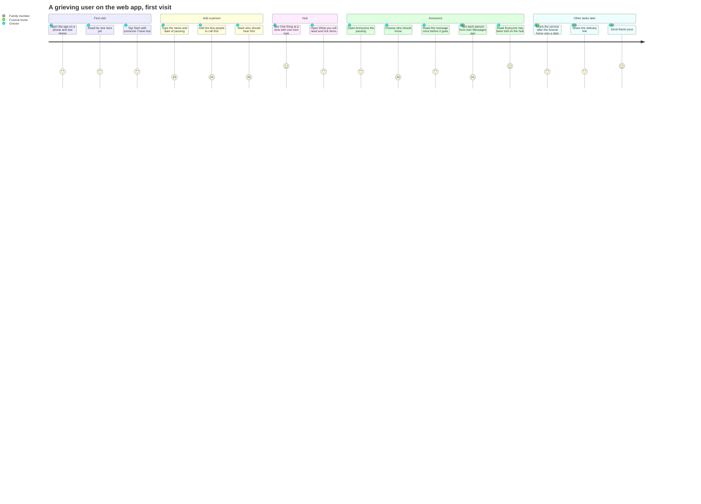
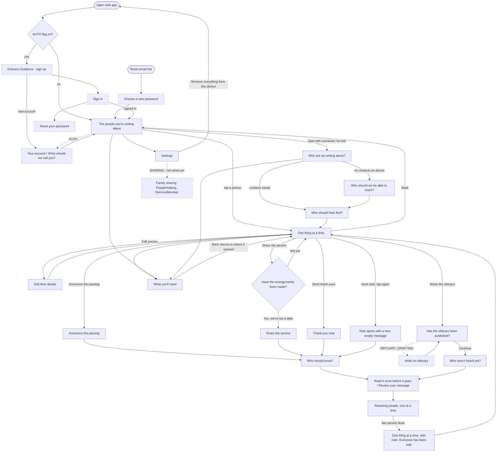
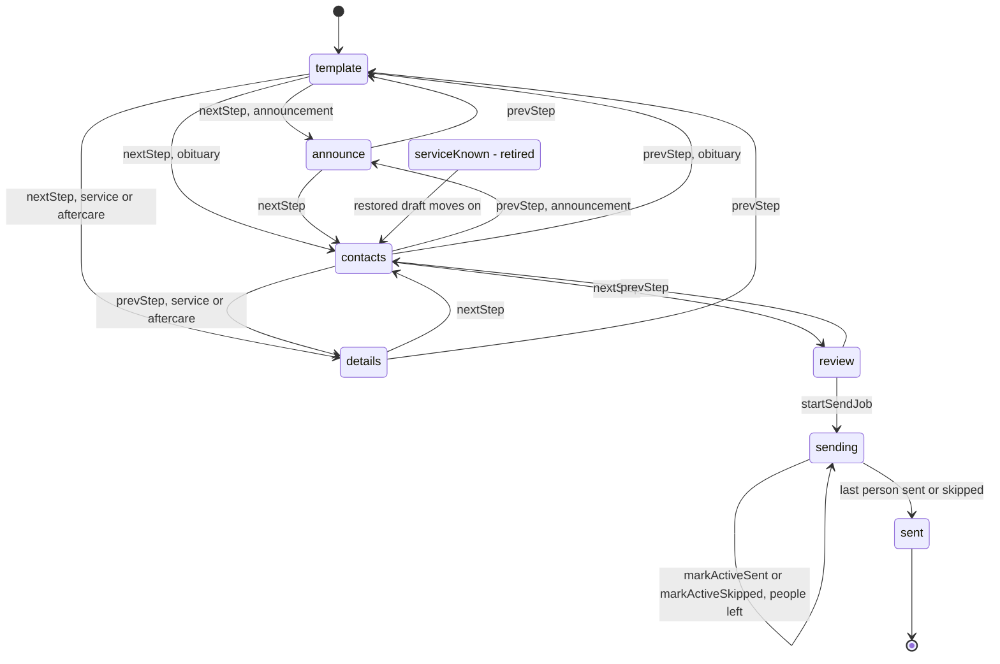

# Front end

This document describes the front end of Griever Guidance as the code is today. It is for Peter
and for future developers.

The user is a person who has just lost someone. They are tired, on a phone, and afraid to forget
something (`REQUIREMENTS.md` §1). Every screen must show one next thing. The constraints C1–C11 in
`REQUIREMENTS.md` §2 are binding.

Facts in this document come from the code on branch `docs/architecture-backend-frontend`. Items
that the code does not prove are marked "not verified". Items from the Linear backlog are marked
"planned".

## 1. Overview

### 1.1 Apps

| App | Stack | Hosted on | Who uses it | Entry file |
|---|---|---|---|---|
| `apps/web` | React 19, Vite, Tailwind 4, Phosphor icons | Cloudflare Pages project `griever-guidance-web` at `web.grieversguidance.com` | The grieving user, on a phone browser. This is the main product. | `apps/web/src/main.tsx` (renders `App` from `apps/web/src/app/app.tsx`) |
| `apps/mobile` | Expo 54, React Native 0.81, React Navigation (native stack) | Not deployed. No deploy job exists in `.github/workflows/deploy.yml`. | Developers today. Later, the grieving user as a native app. | `apps/mobile/src/app/App.tsx` |
| `apps/marketing` | Astro, one page | Cloudflare Pages project `griever-guidance-marketing` at `grieversguidance.com` | A visitor who has not started yet | `apps/marketing/src/pages/index.astro` |
| `apps/web-e2e` | Playwright and `@axe-core/playwright` | Runs in CI only | Developers and CI | `apps/web-e2e/src/*.spec.ts` |

The marketing page has one call to action. It links to `PUBLIC_WEB_URL` (default
`https://web.grieversguidance.com/`).

### 1.2 How web and mobile share code

Web and mobile use the same libraries in `libs/`. The shared code holds the rules of the product.
Each app holds only its screens and its storage adapters.

| Library | What the front end uses it for | Web | Mobile |
|---|---|---|---|
| `@griever/shared` | Message templates (`templates.ts`), `composeMessage`, types (`Contact`, `TemplateCategory`, `MomentKey`), date helpers | Yes | Yes |
| `@griever/hooks` | `useSendFlow` (the message state machine), `useSessions` (people and drafts), `useContacts`, `usePathMoments`, `useAccount` | Yes | Yes |
| `@griever/data-local` | IndexedDB stores: contacts, account (checklist ticks, sender name), meta | Yes | No. Mobile has its own AsyncStorage copy in `apps/mobile/src/lib/contactStore.ts`. |
| `@griever/data-sync` | Removed in #203 (was device id, gateway URL, service worker and Background Sync registration) | No | No |
| `@griever/contacts` | Contact import sources and phone normalizing | Yes | Yes |
| `@griever/api-client` | Gateway calls | Yes | Yes |

There is no `ui-web` library in the repo today. The web UI parts live in
`apps/web/src/lib/ui.tsx` and `apps/web/src/styles.css`.

The web app imports one screen per view in `app.tsx`. A message flow is one `Flow` component
(`apps/web/src/app/Flow.tsx`). `Flow` calls `useSendFlow` and shows one screen per flow step.
Mobile does the same in `SendSession` in `App.tsx`.

## 2. Screens

The heading column shows the words the user sees in the `<h1>` (web) or the title text (mobile).

### 2.1 Web screens (`apps/web/src/screens/`)

The app keeps the current view in one `useState` in `app.tsx` (type `AppView`). There is no URL
router. The browser Back button does not move between views (not verified in a browser).

| Screen (heading users see) | File | Reached from | Goes to | Feature flag |
|---|---|---|---|---|
| "The people you're writing about" | `Home.tsx` | App start (flag off). After sign-in. Back from the hub. Fallback for any view with no person open. | "Who are we writing about?" (button "Start with someone I've lost" or "Someone else I've lost"). The hub of a listed person. Settings. "Your account" (AUTH). "What you'll need". | None |
| "Who are we writing about?" (new) or "Edit their details" (edit) | `SessionSetup.tsx` | Home create button. "Edit person" on the hub or on a form. | "Who should we be able to reach?" when this device has no contacts. "Who should hear first?" when it has contacts. The hub when editing. | None |
| "Who should we be able to reach?" | `AddContactsManual.tsx` | "Who are we writing about?" (first person on a device) | "Who should hear first?" | None |
| "Add from your contacts" or "Add people by hand" | `ImportContacts.tsx` | No button in the current code opens this view (checked with grep in `app.tsx` and the screens). Not reachable. | "Who should hear first?" | None |
| "Who should hear first?" | `WhoHearsFirst.tsx` | Contacts step, or setup when contacts exist | The hub | None |
| "One thing at a time." (the hub, also called the path) | `PathLanding.tsx` | End of the add-person walk. Tapping a person on Home. End of every send, with a note such as "Everyone has been told." | The four tasks: Announce the passing, Share the service, Share the obituary, Send thank-yous. "What you'll need". "Edit person". Back to Home. | None |
| "Announce the passing" | `AnnounceForm.tsx` | Hub, task "Announce the passing" | "Who should know?" | None |
| "Have the arrangements been made?" | `Gate.tsx` | Hub, task "Share the service", when the service is not ready and no draft exists | "Share the service" form (Yes). The hub with a reminder in 24 hours (Not yet). | None |
| "Share the service" or "Thank-you note" (template name) | `DetailsForm.tsx` | Gate (Yes), or the hub when the service is ready. Hub, task "Send thank-yous". | "Who should know?" | None |
| "Has the obituary been published?" | `ShareObituary.tsx` | Hub, task "Share the obituary" | "Who hasn't heard yet?" (Continue). "Write an obituary" (drafting button). | `OBITUARY_DRAFTING` (button is disabled with an "in beta" tooltip when off) |
| "Write an obituary" or "Obituary draft" | `ObituaryScreen.tsx` | "Has the obituary been published?" | Back to "Has the obituary been published?" | `OBITUARY_DRAFTING` (no gateway call when off) |
| "Who should know?" | `ContactSelector.tsx` | Announce, service and thank-you forms | Review | None |
| "Who hasn't heard yet?" | `WideningCircle.tsx` | Obituary flow | Review | None |
| "Read it once before it goes" (announcement) or "Review your message" (other tasks) | `ConfirmScreen.tsx` | Contact step | "Reaching people, one at a time" | None |
| "Reaching people, one at a time" | `SendingScreen.tsx` | Review | The hub with a finish note after the last person | None |
| "What you'll need" | `WhatYoullNeed.tsx` | "What you'll need" button on the hub, on Home and setup screens (via `TopBar`), and on flow screens | Back to the screen it was opened from (`CHECKLIST_RETURNS` in `app.tsx`). From a flow or gate it returns to the hub. | None |
| "Settings" | `Settings.tsx` | Home | Home. "Remove everything from this device" clears the device and restarts at the first screen. | None |
| "Your account" or "What should we call you?" | `Profile.tsx` | Home ("Your account"). Straight after sign-up. Any screen when the account has no name. | Home, or the screen the name prompt interrupted. Sign out goes to sign-up. | `AUTH` |
| "Accounts aren't available right now" | inline in `app.tsx` (`AuthGate`) | App start when the auth client fails to load and no session is stored | Same screen ("Try again") | `AUTH` |

Family sharing screens exist as components but are **not wired** into `app.tsx` today:

| Component | File | Status |
|---|---|---|
| People helping section (`<h2>`, invite by email) | `PeopleHelping.tsx` | Has tests. No view in `app.tsx` renders it. |
| Remove a member section (`<h2>`) | `RemoveMember.tsx` | `Settings` accepts a `removeMember` prop. `app.tsx` does not pass it. |

`SHARING_ENABLED` is defined in `apps/web/src/lib/features.ts`. No non-test file reads it today.

### 2.2 Mobile screens (`apps/mobile/src/screens/`)

Mobile has a different shape. Home lists people. Opening a person shows a template picker. There
is no hub screen, no gate and no obituary screen.

| Screen (heading users see) | File | Reached from | Goes to | Feature flag |
|---|---|---|---|---|
| "The people you're writing about" | `HomeScreen.tsx` | App start. "Back" on the hub (there is no Home link in the send steps; Back from a first form goes to the hub, and Back there goes Home). End of a send, with a note. | The hub. "What you'll need". "Your account" (AUTH). | None |
| "One thing at a time." (hub, shared with web from libs/ui) | `HubScreen.tsx` | Opening a person. End of setup. Back from a moment's first form. | Details form for the chosen step. "What you'll need" sheet. Paywall placeholder. | PAYMENTS (locked rows) |
| Template name, for example "Announce the passing" or "Share the service" | `DetailsFormScreen.tsx` | Hub. Used for the `announce` and `details` steps. | Contact selector | None |
| "Who should know?", "Add from your contacts" | `ContactSelectorScreen.tsx` | Details form | Confirm | None |
| "Review your message" | `ConfirmScreen.tsx` | Contact selector | Sending | None |
| "Reaching people, one at a time" | `SendingScreen.tsx` | Confirm | Home with a note | None |
| "What you'll need" | `WhatYoullNeedScreen.tsx` | Home and picker | Back | None |
| "Your account", "Create an account", "Sign in", "Check your email", "What should we call you?" | `AccountScreen.tsx`, `SignUpScreen.tsx`, `SignInScreen.tsx`, `ProfileScreen.tsx` | "Your account" on Home | Back | `AUTH` |

### 2.3 Marketing

One page: `apps/marketing/src/pages/index.astro`. It has a hero with an `<h1>` and a link to the
web app.

## 3. User journey diagrams

GitHub renders the Mermaid blocks below.

### 3.1 The main journey of the grieving user (web, flags off)

The scores show how the user probably feels at each step (1 = hard, 5 = calm). They are a design
judgement, not measured data. The tasks themselves are hard; the app aims to make them less
hard.

### 3.2 Web screen map (current code)

Dashed boxes depend on a feature flag. "Family sharing" is shown as not wired because no view
renders it yet.

Notes on the map:

1. A done task on the hub shows "Send again". A tap opens a new, empty message for that task. The
   old wording is not kept (C2).
2. A half-written task shows "Started". A tap resumes it.
3. Back on the first form of any task goes to the hub.
4. The obituary task skips the details form. It goes straight to "Who hasn't heard yet?".

### 3.3 Planned changes (Linear backlog, not built)

> **Planned.** None of this is in the code yet. Source: Linear team GRI, backlog on 2026-10-20.

```mermaid
flowchart TD
  subgraph planned["PLANNED - not built yet"]
    pStart(["Open web app"]) --> pSignin{"Signed in?"}
    pSignin -- "no, AUTH on" --> pMagic["Sign in with a magic link - Clerk - GRI-23"]
    pMagic --> pNew
    pSignin -- "yes, or AUTH off" --> pNew{"Has at least one person?"}
    pNew -- "no" --> pIntro["Intro: samples of the announcement, service details and thank-yous - GRI-12"]
    pIntro -- "Start with someone I lost" --> pSetup["Who are we writing about? - What you'll need at the top - GRI-13"]
    pNew -- "yes" --> pHome["Who you're writing about - renamed, no checklist link - GRI-10"]
    pHome --> pSetup
    pSetup -- "What you'll need" --> pSheet["Checklist sheet over the form, Close or Escape - GRI-13"]
    pSheet --> pSetup
    pSetup --> pHub["One thing at a time. - What you'll need in the header next to Back - GRI-14"]
    pHome --> pHub
    pHub --> pAnnounce["Announce the passing - first one is free - GRI-15"]
    pAnnounce --> pPayNote["Calm note: the next tasks need payment - GRI-20"]
    pPayNote --> pHub
    pHub --> pLocked{"PAYMENTS flag on and not paid?"}
    pLocked -- "yes" --> pLockedTasks["Share the service, thank-yous shown as locked - GRI-19"]
    pLockedTasks --> pCard["Create profile: add card details - GRI-21"]
    pCard --> pService
    pLocked -- "no" --> pService["Share the service"]
    pService --> pReview["Review your message - editable, with a sample - GRI-16"]
  end

  classDef plan fill:#fff7e6,stroke:#b26b00,stroke-dasharray: 4 4
  class pIntro,pSetup,pHome,pSheet,pHub,pAnnounce,pPayNote,pLocked,pLockedTasks,pCard,pService,pReview,pMagic,pSignin,pNew,pStart plan
```

| Ticket | Planned change | Touches today |
|---|---|---|
| GRI-12 | New-user intro with samples, then "Start with someone I lost". A repeat user skips it. | `Home.tsx`, `app.tsx` first view, mobile `HomeScreen.tsx` |
| GRI-10 | Rename "The people you're writing about" to "Who you're writing about" and remove its "What you'll need" link | `Home.tsx` (`TopBar`), mobile `HomeScreen.tsx` |
| GRI-13 | "What you'll need" button at the top of "Who are we writing about?" opens a sheet, not a new screen | `SessionSetup.tsx`, `whatYoullNeedContext.tsx` |
| GRI-14 | Hub: move "What you'll need" into the header next to Back | `PathLanding.tsx` |
| GRI-15, GRI-19, GRI-20, GRI-21 | Paywall behind a `PAYMENTS` flag: first announcement free, locked tasks, a calm note, card details | New flag in `features.ts` (does not exist yet) |
| GRI-16 | "Review your message" for "Share the service": the user can edit the text and see a sample. Today only the announcement review has "Edit wording". | `ConfirmScreen.tsx` (web and mobile) |
| GRI-23 | Magic-link sign-in with Clerk. Replaces Supabase Auth. | `SignIn.tsx`, `authClient.ts`, `useAccount`. The old `SignUp`, `CreateAccount`, `ForgotPassword` and `ChooseNewPassword` screens were removed (#326) |

## 4. State and data on the device

The device is the source of truth (C5). Nothing inside a flow waits on the network.

### 4.1 What the web app stores

| Data | Where | Key or store | Written by |
|---|---|---|---|
| People (sessions), each with one draft per task, sent records, service date, reminders | `localStorage` | `gg.sessions.v1` | `useSessions` in `libs/hooks/src/useSessions.ts`, given `window.localStorage` in `app.tsx` |
| Contacts (only the 7 `Contact` fields, C4) | IndexedDB database `gg`, store `contacts` | key `contactId` | `contactStore` in `libs/data-local`, through `useContacts` |
| "What you'll need" ticks | IndexedDB `gg`, store `account` | record `checklistTicks` | `accountStore.setChecklistTicks` in `WhatYoullNeed.tsx` |
| Sender name | IndexedDB `gg`, store `account` | record for the sender name | `accountStore` |
| Device id, gateway URL | IndexedDB `gg`, store `meta` | Removed in #203 (no sync registration at boot) | None |
| Outbox and send jobs | IndexedDB `gg`, stores `outbox`, `sendJobs` | | `libs/data-local` (sync was removed in #203) |
| Clerk session | Clerk's own storage | not verified | Only when `AUTH` is on |

The send job (who is being texted right now) is not saved. A reload in the middle of sending comes
back on the review screen. A finished send keeps no wording (C2).

Saved contacts are cleared 30 days after the latest known service date
(`getContactsRetentionExpiry`).

"Remove everything from this device" in Settings calls `removeEverythingFromDevice`
(`apps/web/src/lib/removeFromDevice.ts`). It clears local data and signs out locally.

### 4.2 What the mobile app stores (AsyncStorage)

| Data | Key |
|---|---|
| People and drafts | `gg.sessions.v1` |
| Open person | `gg.activeSession.v1` |
| Contacts | `gg.contacts.v1` |
| "What you'll need" ticks | `gg.checklist.v1` |
| Profile (with `AUTH` on) | `gg.profile.v1` |

The key `gg.checklist.v1` is mobile only. The web app keeps ticks in IndexedDB, not under this
key.

### 4.3 The `useSendFlow` state machine

`useSendFlow` (`libs/hooks/src/useSendFlow.ts`) holds one message flow. The step list depends on
the template category (`stepsFor`):

| Category | Steps |
|---|---|
| `announcement` | template → announce → contacts → review → sending → sent |
| `obituary` | template → contacts → review → sending → sent |
| `service`, `aftercare` | template → details → contacts → review → sending → sent |

Rules in the hook:

1. `startSendJob` makes the first person "sending" and the rest "queued". The app opens one `sms:`
   link at a time. There is no bulk send (C1).
2. `markActiveSent` marks the person "delivered". `markActiveSkipped` marks the person "skipped".
   Both move to the next person. When all are done, the step becomes `sent`.
3. A draft saved on `sending` restores on `review`. A draft saved on the retired `serviceKnown`
   step, or an announcement draft on `details`, restores on `contacts`.
4. `resumeDraft` moves a draft that sits on `template` to the first form of its task.
5. `startAgain` empties the current task's draft and returns to its first form. It does not
   touch the person, the contacts or the sent record.
6. The web `Flow` treats the `template` step as "go to the hub". Only mobile shows a picker.
7. Any edit to a field clears `messageOverride`. The review screen pins the exact text before the
   send starts.

## 5. Feature flags

Each flag is read at build time. Only the exact string `"true"` turns a flag on. A missing
variable keeps the feature off.

| Name | App | Env var | Default | Effect |
|---|---|---|---|---|
| `AUTH_ENABLED` | web | `VITE_FEATURE_AUTH` | off | On: the app starts at sign-up, loads Clerk in its own chunk, and shows account screens and "Your account". Off: the app starts at Home and loads no auth code. |
| `OBITUARY_DRAFTING_ENABLED` | web | `VITE_FEATURE_OBITUARY_DRAFTING` | off | On: "Write the obituary" calls the gateway obituary route. Off: the button shows, disabled, with an "in beta" tooltip. The deploy workflow does not set this variable, so production is off. |
| `SHARING_ENABLED` | web | `VITE_FEATURE_SHARING` | off | Meant to turn on family sharing (invite, join, remove). No screen reads it yet. The deploy check fails if `FEATURE_SHARING` is on and `FEATURE_AUTH` is off. |
| `CMS_ENABLED` | web | `VITE_FEATURE_CMS` | off | On: Home opens the web editor (Overview, The person, Service) instead of the path; no send flow, wizard or `sms:` link is reachable. Off: the app is unchanged. Production is on (repo variable `FEATURE_CMS`, passed by the deploy workflow). |
| `AUTH_ENABLED` | mobile | `EXPO_PUBLIC_FEATURE_AUTH` | off | On: wraps the app in `AccountProvider` and adds "Your account" on Home and the picker. Off: no account code runs. |
| `PAYMENTS` | web, mobile | not defined | n/a | Planned (GRI-15). Does not exist in the code. |

Production values come from GitHub repo variables `FEATURE_AUTH`, `FEATURE_SHARING` and `FEATURE_CMS`, passed to
the web build in `.github/workflows/deploy.yml`.

## 6. Accessibility and copy rules in practice

1. **Touch targets are at least 44 px.** `.gg-btn` and `.gg-input` have `min-height: 44px` in
   `styles.css`. `.gg-btn-bar` adds `min-width: 44px` for the Back and "What you'll need" bar
   buttons. Checklist rows use `min-h-[44px]`. Home person rows set `minHeight: 44`. Mobile
   checklist rows use `minHeight: 44`.
2. **Focus follows the screen.** `useFocusHeadingOnChange` moves focus to the new `<h1>` when the
   view or flow step changes. It waits for the first user input, so start-up redirects do not
   steal focus.
3. **Live regions stay mounted.** `app.tsx` keeps `role="status"` regions in the page at all times.
   It fills them after a short delay, so a screen reader reads:
   1. the finish note ("Everyone has been told." plus the no-copy line),
   2. "Everything has been removed from this device.",
   3. "You've been signed out. Your work on this device is safe.".
   Loading text appears only after 500 ms, so a fast load does not flash. On mobile, Home uses
   `accessibilityLiveRegion="polite"` and, on iOS, `announceForAccessibilityWithOptions`.
4. **Checklist ticks are toggle buttons.** Each row is a `<button aria-pressed>`. It is disabled
   until saved ticks load, so an early tap cannot overwrite them.
5. **Icons are hidden from screen readers** with `aria-hidden="true"` where a text label exists.
6. **Calm copy (C7).** No exclamation points and no celebration. The tests
   `apps/web/src/copyTone.spec.ts` and `libs/shared/src/copyTone.spec.ts` check this. Examples from
   the code: "Not yet. We'll check back tomorrow. Nothing is late." and "We won't remind you about
   this list."
7. **No deletion in a flow (C9).** Removal is only in Settings, as a button with a confirm step.
8. **One recipient per `sms:` link (C1).** The user sends each text from their own Messages app.
9. **E2E checks.** `apps/web-e2e/src/a11y.spec.ts` runs axe for WCAG A and AA, checks contrast, and
   checks for one `<h1>` and a page language. It runs on desktop Chrome, in CI only.

## 7. How to run, build and test

Use `pnpm`. Do not use npm or yarn. Run commands from the repo root.

### 7.1 Run the apps

1. Install packages: `pnpm install --frozen-lockfile`.
2. Run the web app with the whole local stack: `pnpm dev:local web`.
3. Run the mobile app (Expo) with the whole local stack: `pnpm dev:local mobile`.
4. Run the marketing site: `pnpm dev:marketing`.
5. To turn on a flag locally, copy `apps/web/.env.example` and set the flag to `true`. Do not put
   secrets in the example file.

### 7.2 Build and check

1. Typecheck all projects: `pnpm typecheck`.
2. Run all unit and integration tests (Vitest): `pnpm test`.
3. Build all projects except mobile: `pnpm build`.
4. Run all three: `pnpm check`.
5. Run only what your branch changed: `pnpm check:affected`. Run this before you report a ticket
   done.

### 7.3 End-to-end tests

1. Do not run `pnpm e2e`, `nx e2e` or `playwright test` on a local machine.
2. Push the branch and open a draft PR.
3. Read the CI `e2e` job: `gh pr checks`, then `gh run view --log-failed` on a failure.
4. For repeat runs, use the manual `E2E stress` workflow in CI.

The e2e specs are `home.spec.ts`, `onboarding.spec.ts`, `announce.spec.ts`,
`service-gate.spec.ts` and `a11y.spec.ts` in `apps/web-e2e/src/`.

## 8. Sources

Web app:

- `apps/web/src/main.tsx`
- `apps/web/src/app/app.tsx`
- `apps/web/src/app/Flow.tsx`
- `apps/web/src/screens/*.tsx`
- `apps/web/src/lib/features.ts`
- `apps/web/src/lib/ui.tsx`
- `apps/web/src/lib/whatYoullNeedContext.tsx`
- `apps/web/src/lib/unregisterOldWorker.ts` (removes the old service worker; `registerSync.ts` was removed in #203)
- `apps/web/src/lib/removeFromDevice.ts`
- `apps/web/src/styles.css`
- `apps/web/.env.example`

Mobile app:

- `apps/mobile/src/app/App.tsx`
- `apps/mobile/src/screens/*.tsx`
- `apps/mobile/src/lib/features.ts`
- `apps/mobile/src/lib/contactStore.ts`
- `apps/mobile/src/lib/useDeviceSessions.ts`
- `apps/mobile/src/lib/authStorage.ts`

Marketing: `apps/marketing/src/pages/index.astro`

Libraries:

- `libs/hooks/src/useSendFlow.ts`
- `libs/hooks/src/useSessions.ts`
- `libs/data-local/src/db.ts`
- `libs/data-local/src/accountStore.ts`
- `libs/data-sync/src/localStorageKeys.ts`
- `libs/shared/src/templates.ts`

Tests and process:

- `apps/web-e2e/src/*.spec.ts`
- `PROCESS.md` §7 and §8
- `REQUIREMENTS.md` §1, §2, §6 "Domain and hosting"
- `.github/workflows/deploy.yml`

Planned work: Linear team GRI, issues GRI-10, GRI-12, GRI-13, GRI-14, GRI-15, GRI-16, GRI-19,
GRI-20, GRI-21, GRI-23.
