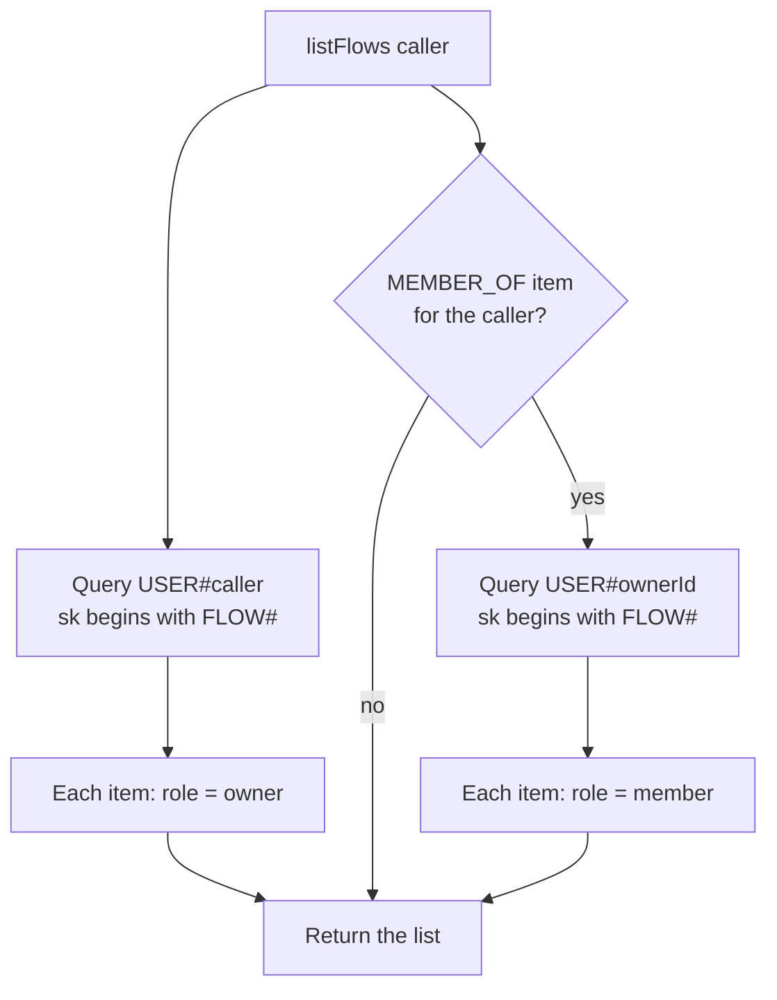
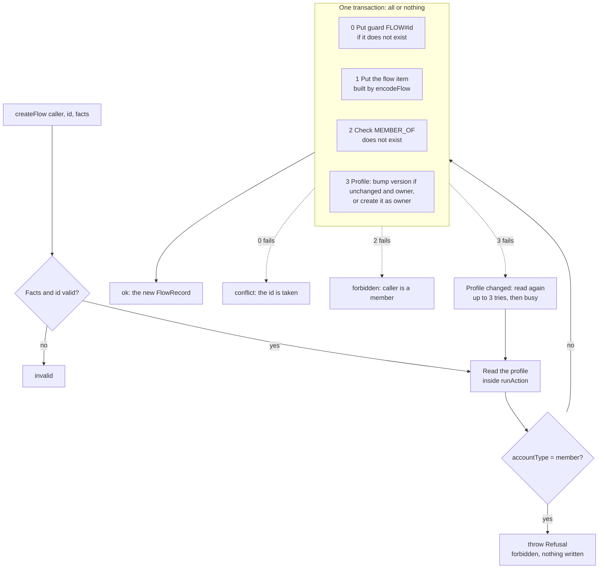
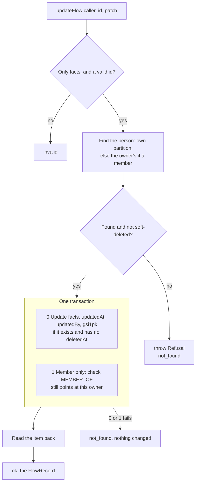

# Learning log: the aws-be move

Peter builds the `aws-be` tickets himself, one step at a time. Each step records the system decision, the
questions Peter asked, and the answers. The focus is the concepts and the decisions, not line-by-line code.

## #270: profile and shared-people access rules

### Step 1: the flow item codec

**What we built.** `encodeFlow()` in `libs/data-access/src/items/flowItem.ts` turns one shared person into
the exact DynamoDB item that is stored, and nothing more.

**The decision.** On Supabase, the `flows` table has fixed columns, so the database itself refuses an
unknown field. DynamoDB stores any attribute it is given. So the "columns" now live in code: the codec
lists every attribute by name, and a test fails if one is added or if a name looks like contact data,
drafts or message text (C2, C3). The facts go through `parseFlowFacts` from `libs/shared`, the same
whitelist the apps use, so the server and the apps cannot disagree on what a fact is.

**Questions and answers.**

- **Why does a test fail when a fact has an extra key?** `parseFlowFacts` rejects unknown keys. It does
  not drop them. So a stray `contactId` gets an error, not a silent save (C8).

### Step 2: listFlows, who sees which people

**What we built.** `listFlows()` in `libs/data-access/src/rules/flows.ts` returns the people the caller
may see, each with a role.

**The decision.** On Supabase, RLS policies hid other people's rows. DynamoDB has no RLS. So we get the
same effect by choosing which partitions we query. We query the caller's own partition. If the caller has
a `MEMBER_OF` item, we also query the owner's partition. We never query anyone else's partition, so a
stranger gets `[]`.

**Questions and answers.**

- **Why did Vitest find no tests?** The `it(...)` blocks were inside `beforeAll`. Vitest only collects
  tests at the `describe` level.

### Step 3: createFlow, one transaction with four checks

**What we built.** `createFlow()` in `libs/data-access/src/rules/flows.ts` creates a person for the
caller, as owner. A member can never create one (C11).

**The decision.** On Supabase, a trigger and a row lock kept this safe. In DynamoDB, one
`TransactWriteItems` call writes or checks four items, and either all succeed or none do. Each item has a
position. When a condition fails, DynamoDB reports the position, and the rule turns it into a reason.

**Questions and answers.**

- **Why do we need the `Refusal` class?** `runAction` always sends the writes that the action returns. It
  has no "stop" option. If a member reached the transaction, position 3 would fail, `runAction` would take
  it for a version change, retry 3 times, and return `busy` instead of `forbidden`. So the action reads the
  profile, sees `member`, and throws. The class lets the `catch` tell our planned "no" apart from a real
  error.
- **Why is the check inside the action and not before `runAction`?** Because of the race. If the profile
  changes mid-write, `runAction` reads again on the retry. That second read must also refuse a member.
- **Could we remove `Refusal`?** Yes, if `runAction` let an action return "no writes, here is the
  answer". That changes `transact.ts`, which is outside #270. We kept `Refusal` for now.

**The mutation test.** We deleted the `MEMBER_OF` check (position 2) and ran the tests. "Refuses a user
with only a MEMBER_OF item" failed: that user could create a person. "Refuses a member" still passed,
because the profile check stopped that user first. So each C11 guard has its own test. We restored the
check, and all tests passed again.

### Step 4: updateFlow, facts only, for the owner or a current member

**What we built.** `updateFlow()` in `libs/data-access/src/rules/flows.ts` changes facts on a person.

**The decision.** On Supabase, column grants allowed only the fact columns, and RLS allowed only the owner
and members. Here `parseFlowPatch` rejects any key that is not a fact, so `ownerId` or `updatedAt` gets
`invalid`. The rule then finds the person in the caller's partition, or in the owner's partition for a
member. A stranger, an unknown id and a soft-deleted person all get `not_found`, not `forbidden`, so a
stranger cannot learn that a person exists.

**Questions and answers.**

- **Why read the item back after the commit?** Two people can edit different facts at the same time.
  The read shows both edits, not only ours.

### Step 5: profiles, only your own name and contact source

**What we built.** `getProfile()` and `putProfile()` in `libs/data-access/src/rules/profiles.ts`.

**The decision.** On Supabase, column grants let a user change only `sender_name` and `contact_source`,
and check constraints set the limits. Here a small parser does the same: only those 2 keys, a name of at
most 100 characters, a source of `import`, `manual` or null, and null clears a field. Both functions use
`caller.userId`, so no input can point at another user. `accountType`, `version` and `createdAt` are never
taken from the input.

**Questions and answers.**

- **Why count the name with `[...name].length`?** Postgres `char_length` counts characters. JavaScript
  `.length` counts UTF-16 units, so one emoji counts as 2. The spread counts it as 1, like Postgres.
- **Why not cast `senderName as string`?** The cast tells TypeScript the value is never null, but null
  still reaches the table. We changed `ProfileFields` to allow null, so the types tell the truth.
